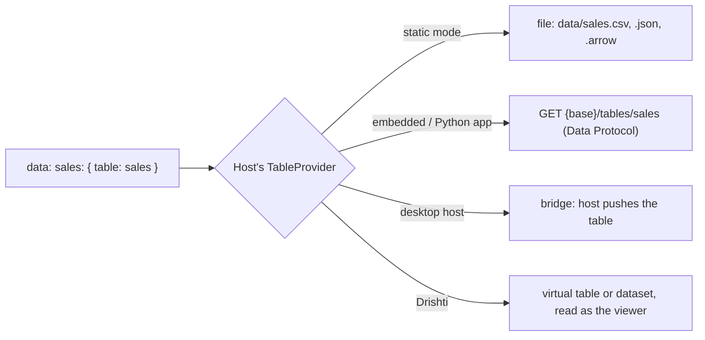
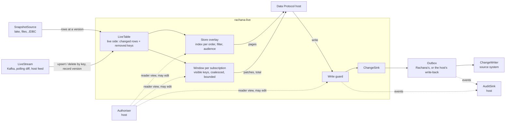

<!-- Copyright (c) 2026 Ashutosh Sinha. Proprietary. All rights reserved. -->
# Design

The design behind Rachana as built: where Sutra Core ends and a profile begins, the compiler and its runtimes, the fragment-library framework, live tables, and the boundary that makes a Sutra safe for an AI assistant to write. The decisions that shaped it are in [DECISIONS.md](DECISIONS.md); what is still planned is in [ROADMAP.md](ROADMAP.md); the rules themselves are in [SPEC.md](../spec/1/SPEC.md).

## Sutra Core and profiles: design

### 1. The line

**Sutra Core** is everything about a *screen* and *rows*: what a browser, a Python app or a Java service can do with
a Sutra and tables, with no platform behind it.

A **profile** is a named set of additions a host registers: entity kinds, document matching, extra panel kinds,
functions that need an engine, data sources that need a catalogue, governance. **Drishti's profile** (`drishti`) is the
first. A profile adds; it never changes what Core means.

| Sutra Core (this repository) | Drishti profile (stays in Drishti) |
|---|---|
| identity, prose, docstring | `match` (kind, where, priority), `domain`, matching and its trace |
| title, strip, 20 panel kinds, layout, phone | panel kinds `links`, `provenance` |
| controls, events (`emits`, `waits`, `children`), `on-select`, `keys`, `refresh` | key actions `impact`, `raw`; mnemonics and command codes |
| `data:` and `source: { table }` | `source: { kind, id, where, search, pack, params, as-of }`, linked-entity `source: "link(…)"` |
| forms: fields, rules, hints, steps, drafts | `form.save` (write-back targets, connectors, approvals), `editable-by` roles |
| fragments (`use:`), given a resolver | where fragments come from: the UI kit folder, pack folders, precedence |
| Rachana-EL, Core functions, list aggregates, checked mode | model functions: `measure`, `cell`, `calc`, `share_of`, `parent_of`, `as_of`, `convert`, `fx`, `related`, `related_rows`, `label`, time intelligence and windows over a model |
| formats and tones (the shared tables) | formats added by packs |
| masked values (the value and its propagation) | who is masked: roles, row rules, reading "as the viewer" |
| binding a Sutra to data: the ViewModel and patches | inference from the catalogue, link resolution, badges, provenance, computed (reactive) sources |
| schema generation, editing operations, writer | registry over pack and site directories, hot reload, governance, "under construction", context help (`about.yaml`) |

### 3. The profile mechanism

#### 3.1 Shape

A profile is a value built in code and handed to the compiler. Nothing is discovered by scanning; nothing is global.

```java
Profile host = Profile.named("host")
    .keys(...)            // top-level keys and their readers (SutraKey)
    .panelKinds(...)      // panel kinds beyond Core's
    .sourceForms("kind")  // source forms a panel's `source:` may take
    .functions(provider)  // a FunctionProvider: names, signatures, implementations
    .formats("host-formats.yaml")
    .calendars(resolver)  // business calendars for the date functions
    .formSave()           // the profile's form `save` key
    .fragments(resolver)  // where `use:` finds fragments
    .build();

Rachana rachana = Rachana.with(RachanaOptions.DEFAULTS, Profile.core(), host);   // also Rachana.core() and Rachana.at("1.2", options, profiles...)
Optional<Profile> p = rachana.profile("host");
```

The compiler is `rachana.parser()` (Sutra text to a Sutra or its problems) and `rachana.compiler()` (one expression); the binder is `rachana.binder(hooks, pivots)` and `rachana.views(...)`, with `BindHooks` carrying the host's links, the binders of the panel kinds a profile adds, labels and limits. A runtime that has a profile's declarative half but not its behaviour compiles the Sutra and marks the affected panels unsupported, never failing the screen.

#### 3.2 What a profile can register

| Extension point | Declares | Behaviour (host code) |
|---|---|---|
| top-level key | name, shape, `since` | a `SutraKey` reader that fills a typed extension of the Sutra |
| panel kind | name, required and accepted options | a `PanelBinder` (in `BindHooks`) that produces the panel's data |
| source form | the discriminating key (`kind`) | the host's resolver of rows, as the viewer |
| function | a full catalogue entry (SPEC section 5) | the implementation in a `FunctionProvider` |
| format | name, spec | none (data), through `formats(...)` |
| calendar | the business calendar | `Calendars.Resolver` |
| form `save` | the profile's write-back key | the host's save path |
| fragment source | where `use:` finds blocks | `FragmentResolver` |

#### 3.3 Rules

1. A profile **cannot** redefine a Core key, kind, option, function, format or code. Registration fails at start-up
   (as `Functions.register` refuses a duplicate name today). One way per job: a host that kept its own copy of a Core
   function (an engine's `sum`, a grouping behind `group(...)`) drops it from its `FunctionProvider`; `Rachana.with`
   refuses the instance with `Rachana-EL function sum is Core's: a profile cannot redefine it (<provider> provides it
   too; ...)`, and Core's is the one every Sutra reads.
2. A profile's names are plain (`match`, `links`).
3. A Sutra's `profiles:` key (planned, SPEC 2.2) will let a file say which profile it needs; until then a host with one default profile set loads it for every Sutra.
4. Core's conformance suite must pass with any profile loaded.
5. The ViewModel a profile's binder produces uses Core's panel envelope; profile facts go under the panel's or the
   view's `meta.<profile>`, which painters hand back in events and never interpret.

#### 3.4 Hooks a host implements (not profile-specific)

| Hook | Purpose | Default in Core |
|---|---|---|
| `TableProvider` | resolve a `table:` name to schema, rows, pages, changes (the Data Protocol's server side, in process) | none: an unknown table is `RCH-2070` |
| `FragmentResolver` | resolve `use: name@version` to a block | a folder or an in-memory map |
| `LinkResolver` | turn a `link(...)` value into an address or action | links are inert text |
| `Calendars` | business days for date functions | weekends only |
| `Masker` | mark fields masked before binding | nothing masked |
| expression cache | compiled-expression cache, `RachanaOptions.expressionCacheSize` | bounded, per `Rachana` instance |

#### 3.5 Authorisation is never in the profile's declaration

Who may see a table, a row or a field is decided where the data lives: in the host's `TableProvider` and `Masker`,
called with the host's own request context. A Sutra cannot widen access; it can only name data the host then
decides about.

#### 3.6 The value interface

The expression evaluator reads data through one small interface, `Node` (type, field by name, element by index, size,
scalar value, masked, missing), in a module with no dependencies (`rachana-api`). Core ships implementations over
maps and lists, JSON, and Arrow columns (row cursor, no boxing per cell). The product's `DataNode` implements `Node`,
so Drishti keeps its own record type and nothing is copied at the boundary.

- **Node factory** (one SPI, `NodeFactory` in `rachana-api`): a host's node type returns its factory from
  `Node.nodes()`; every list and record an expression builds over a document of that type (a filter, a function's
  result, a list or record literal) comes back through it, in the host's type, with the host's own elements kept as
  they are. A node that names no factory gets Rachana's own (`NodeFactory.core()`).
- **Reading a host's values**: a scalar node that does not give `value()` is read through `asText`, `asDouble` or
  `asBoolean`; a number that gives no number, and a value of a type Core cannot read handed to an aggregate, are
  `RCH-2102` at every level, never a silent 0 or empty. The conformance runtime proves the corpus answers alike over a
  host's own node type (`rachana_conformance.py --jvm --host-nodes`, `HostNodeConformanceTest`).
- **Formats a host adds at run time**: `Rachana.formats()` is a live table (`Formats.live`): `reload(packFiles)` reads
  the bundled table, the packs' files and the site file again and swaps the whole table; every reader (contexts,
  binders, level views) sees it at its next read; a failed reload changes nothing. `Formats.load` stays immutable.
- **Level**: `Rachana.at(level, options, profiles...)` builds an instance pinned at a language level in one call.
- **Sutra JSON**: the record's components are its JSON in order (`name`, `version`, `domain`, `match`, `title`, ...,
  `extensions`); `extensions` lists only other profiles' keys, so a writer of record components (Jackson) needs no
  mix-in, and the canonical constructor reads it back.

### 4. Plain tables as first-class data sources

This settles what the Overview's example guessed (`sources:`, `rows: "sales"`, `sum(sales.revenue)`).

#### 4.1 The keys

| Guess in the first Overview | Settled | Why |
|---|---|---|
| top-level `sources:` | top-level **`data:`** | names the screen's inputs; "source" is already the panel-level key |
| `sales: { table: sales }` | **`sales: { table: sales }`** (kept) | `table` already exists today as a source key (`Wiring.Source.table`) |
| `rows: "sales"` | **`rows: $.sales`** | each `data:` entry is a field of `$`; no new name resolution in the language |
| `value: "sum(sales.revenue)"` | **`value: "sum($.sales, 'revenue')"`** | the list form that exists today; `alias.COLUMN` stays the checked-mode form for models (a profile) |
| `hbar` with `value: "sum(revenue)"` | **`rows: "group($.sales, 'region', 'revenue')"`, `label: label`, `value: value`** | `group` exists today and yields `{label, value, count}` rows |
| column `bind: "@.region"` | kept | |

Full rules for `data:` entries are in SPEC section 2.4.

#### 4.2 How a name is resolved



The screen half of the file is byte-identical in every mode. Promoting a prototype from a CSV file to a governed
table changes where one name points, not the Sutra.

#### 4.3 What the compiler does with a table

1. **Schema.** At compile time the compiler asks the provider for the table's schema (columns and types). With a
   schema, every expression over `$.sales` is checked: a misspelt column is `RCH-2071` with `expected` names. Without
   one (a bare URL not yet read), field names are unchecked, as for documents today.
2. **Plan.** For each panel the compiler records which tables and columns it reads (the dependency paths expressions
   already report), and whether its row condition, sort and limit can be pushed to the provider (the push-down subset,
   DATA_PROTOCOL section 5). The plan is part of the compile result.
3. **Bind.** Rows arrive as `Node`s over JSON or Arrow. Small tables are bound in the runtime; a table the provider
   marks `server` is queried with push-down and never summed locally.
4. **Live.** A keyed table with changes produces ViewModel patches: only the panels and cells whose dependency paths
   include the changed columns are re-evaluated.

#### 4.4 Tables and documents together

A profile whose screens open on a record (Drishti) keeps `$` as that record and adds `data:` entries as further
fields of `$`; a name that collides with a field of the record is `RCH-2073` at bind time in checked hosts and a lint
warning otherwise. Panel-level `source: { table }` gives `$src` as today. So there is one model: `$` is the screen's
record; tables are fields of it.

## Compiler and runtimes: design

### 1. Principles

1. **One compiler source**: the Java reference. JavaScript and WebAssembly are builds of it, not ports.
2. **Byte-identical results** in every runtime, proven by the conformance suite on every change.
3. **Core has no framework**: no Spring, no reflection-based libraries, a short list of JDK packages. That is what
   makes the other builds possible, and it keeps the jar small for JVM hosts.
4. **Thin SDKs**: host-language code (JavaScript, Python) holds transport and glue only. A guard fails the build if an
   SDK grows a parser, an operator or a formatter.
5. **Speed is a release gate**, not a hope (section 7).

### 2. Repository layout

```text
drishti-rachana/
  spec/1/                      the specification, its generated language files, the Data Protocol
  conformance/1/               the cases (section 6)
  java/                        Maven reactor, group com.ash.rachana, Java 21
    rachana-api/               Node, NodeFactory; zero dependencies
    rachana-core/              YAML reader, model, EL, functions, aggregates, formats, checker, binder, patches, profiles, libraries
    rachana-tools/             library tool and gates, signing, the generated language files
    rachana-data/              Data Protocol: host, client, JSON, Arrow and NDJSON rows, reference server
    rachana-live/              live tables
    rachana-server/            the standalone server
    rachana-cli/               the library commands (rachana lib ...)
    rachana-js/                the TeaVM build into js/packages/rachana/dist
    rachana-conformance/       the JVM conformance runtime
    rachana-conformance-cases/ the cases and the specification as a jar
    rachana-compat/            the compatibility regime
    rachana-guards/            the guards
  js/packages/                 rachana (bundles, facade, <rachana-view>), rachana-cli, rachana-studio; rachana-electron is a placeholder
  js/vendor/drishti-elements/  the pinned painter, copied unchanged
  python/                      drishti_rachana: the engine on V8, the Data Protocol host, the Flask and FastAPI adapters
  libraries/                   core and finance
  examples/  tools/  docs/
```

Dependency rule: `rachana-api` <- `rachana-core` <- `rachana-tools`, `rachana-data`, `rachana-live` <- `rachana-server`, `rachana-cli`. `rachana-core` may depend only on `rachana-api` and the JDK.

### 3. The Java reference

#### 3.1 Public API

`Rachana` (`com.ash.rachana`) is the entry point: `Rachana.with(options, profiles...)`, `Rachana.at(level, options, profiles...)` and `Rachana.core()`. Its `parser()` compiles a Sutra, `compiler()` an expression, `formats()` the format table, and `binder(hooks, pivots)` and `views(...)` bind a Sutra to tables. The entry surface (`Rachana`, `RachanaOptions`, `Node`, `ElCompiler`, `Expr`, `Formats`, `LibrarySet`, ...) is marked `[stable]` in `java/api-surface.txt`; everything under an `.internal` package is hidden with the Java module system (`module-info` exports only the public packages), so a host cannot reach in.

#### 3.2 Dependencies

Core uses no framework: no Spring, no Jackson, no reflection-based libraries. It owns a positional YAML reader and a JSON reader and writer (`com.ash.rachana.parse.YamlReader` with `YamlStream`, `YamlScanner`, `YamlEvents`, `YamlScalars`; and `Json`), a bounded expression cache, its own linear-time regular expressions and its own number-to-text and date-to-text routines. The YAML reader reads YAML 1.1 as the reference always did: the same tree and types (`yes` and `on` are booleans, `1.0` a number, `0x1F` 31, dates stay text), positions (1-based, columns in code points), issues (a repeated key keeps the first, a second document, a non-core tag, an anchor or alias) and error texts. `Json` reads plain values (a whole number beyond a `long` as a `BigInteger`) and writes compactly. `tools/yaml-diff` compares both with the reference readers over every YAML file of two checkouts and mutations of them; `YamlReaderTest` checks recorded vectors on every build. Comments are skipped: the Sutra writer keeps its own text edits.

The JDK surface Core is allowed to use is a written allow-list (`java.lang`, `java.util`, `java.util.function`, `java.math`, selected `java.time`), enforced by a guard test over the compiled classes.

### 4. The JavaScript build

#### 4.1 Approach

`rachana-core` and `rachana-tools` are cross-compiled from Java bytecode to JavaScript with a build-time tool of the
**TeaVM** class (pure Java, runs under Maven on Linux and Windows with only a JDK). Two ES module bundles:

| Bundle | Holds | Loaded by |
|---|---|---|
| `rachana.runtime.js` | read a compiled plan, evaluate, bind, patch | every page |
| `rachana.tools.js` | full YAML parse with positions, checker, problems and fixes, completion, editing operations, formatter | editors, playground, CLI, lint |

A hand-written facade (`js/packages/rachana/src`, plain JavaScript with type declarations) wraps them: loading
Sutras and tables, the worker, hand-over of rows, `<rachana-view>`, the bridge. It contains no language semantics.

**Data hand-over.** The compiled core reads data through `Node`. The facade supplies `Node` implementations backed
directly by JavaScript objects and by Arrow columns (through the vendored Apache Arrow JS of Drishti Elements), so
rows are never copied into Java-shaped structures. Above a row threshold the core runs in a Web Worker and Arrow
buffers are transferred, not copied.

#### 4.1a The build

`java/rachana-js` builds both bundles with TeaVM 0.16.0 (in every reactor build, before `rachana-guards` runs the Node suite on them, which fails when they are missing; `python3 tools/js/build_js.py` adds the conformance check, or `./mvnw package -pl rachana-js
-am`; JDK 21, nothing installed). Rachana's own classes reach TeaVM unpacked into the module, so three same-named classes of the
JavaScript build replace Core's: `internal.NumberText` (the engine's shortest digits, Java's layout and number grammar)
and `internal.Bits` (the words of a double through a `DataView`, no
`BigInt`). Two TeaVM files are patched (`StatementRenderer`: the right operand of `+` and `*` keeps its parentheses, DECISIONS D15-2;
`PreciseDependencyAnalyzer`: no domain merging, so the analysis keeps every type and the bundles are the same on every build).
`tools/js/build_js.py` runs the conformance suite on both bundles after every build and fails on any error or verified failure.

| Bundle | Exports (JSON text in and out; answers are the conformance documents of FORMAT 5) |
|---|---|
| `rachana.runtime.js` | `init(profiles, formats)`, `version`, `evaluate`, `evaluateError`, `format`, `check` (parse, then check: compile and lint), `checked` (checked mode over known types, FORMAT 5.4), `grammar` (FORMAT 5.5), `view` |
| `rachana.tools.js` | the runtime's, plus `edit` (design/ops), `viewModelSchema`, and the conformance harness `hello`, `answer` |

**EXPERIMENTAL at 1.0:** these exports are the conformance adapter (a request is a case's fields; `init` sets one
instance for the page) and may change in a minor release; the frozen contract is the JSON documents they answer (FORMAT 5) and
the ViewModel schemas. `screen(op, request)` and `<rachana-view>` are experimental for the same reason.

Every conformance case is byte-identical to the JVM in Node 22, Chromium 153, Firefox 155, WebKit 26.6 (strict CSP,
Trusted Types, no violation) and in Python on V8 (2,123 cases with the tools bundle, 1,953 with the runtime bundle: all but `edit`);
5,600 random maths probes identical. Runners: `tools/conformance/rachana_conformance.py --node [--bundle ...]`,
`js/packages/rachana/runners/run_browsers.py`, `python -m drishti_rachana.engine` (section 5.3). Measurements: section 4.2.

#### 4.2 Proofs

The JavaScript build was adopted on evidence. Every conformance case runs byte-identical in Node, Chromium, Firefox and WebKit (strict Content-Security-Policy and Trusted Types, no violation) and in Python on V8, no engine error reaches a user, and 5,600 random maths probes agree. The differences found between runtimes fell into a small set of classes, each closed by one rule of Core rather than a per-runtime path: transcendental and financial maths through Core's own `CoreMath` (ported fdlibm functions), number text and number reading through Core's own shortest-round-trip code (`internal.NumberText`), the words of a double through a `DataView` (`internal.Bits`), conversions of non-finite doubles, text by code point and case, a fixed locale for every format, and the regular-expression deadline counted in steps. The bundles are reproducible (the same bytes from two clean builds). Size and speed are budgets (section 7): the bundles are about 361 KB (runtime) and 381 KB (tools) in Brotli, and evaluation runs at roughly 14 times a hand-written tree-walking interpreter, a trade accepted for one source of semantics. A WebAssembly build for Python was measured and not adopted: loading the module compiled for 28 to 60 seconds and several gigabytes, and evaluation was about 450 times the JVM.

### 5. The WebAssembly build for Python

#### 5.1 What Python needs

Python hosts (Flask, FastAPI) need to **lint, compile and bind without a JVM**: `check`, server-side render of a ViewModel, `rachana lint` in CI. They do not need it to serve a page: in the browser the JavaScript build compiles. So Python runs the JavaScript bundle on V8.

#### 5.3 Python: the JavaScript bundle on V8

The WebAssembly build was measured and not adopted (section 4.2); Python runs the bundle on V8: `drishti_rachana.engine.Rachana` loads `rachana.tools.js`
(or the runtime bundle) into a V8 isolate through `mini-racer` (extra `v8`) and calls the facade: `check(sutra)` compiles and lints,
`evaluate`, `template`, `format`, `view`, `edit`. `python -m drishti_rachana.engine` is a conformance runtime program (RUNNER 5):
2,123 cases byte-identical to the JVM. The wheel carries the bundles built by `tools/js/build_js.py`.


### 6. The conformance suite

#### 6.1 Format

One YAML file per group under `conformance/1/<area>/`; each case is self-contained. The normative format is
[CONFORMANCE.md](../conformance/CONFORMANCE.md#conformance-case-format-rachana-1) with its JSON Schema; the runner contract is
[CONFORMANCE.md](../conformance/CONFORMANCE.md#the-runner-contract). This section is the outline they were written from.

```yaml
# conformance/1/el/arithmetic.yaml
suite: el/arithmetic
since: "1.0"
profile: core
cases:
  - id: null-in-null-out
    kind: expr
    given: { record: { a: 2 }, ctl: {}, today: "2026-01-15" }
    expr: "$.missing * 2"
    expect: { value: null, text: "", type: "empty" }
  - id: text-join
    kind: expr
    expr: "'Leg ' + 1"
    expect: { value: "Leg 1" }
```

| `kind` | Input | Expected |
|---|---|---|
| `expr` | expression, record, row, controls, today | value (canonical JSON), display text, paths read |
| `expr-error` | expression | problem: code, span, message, `expected`, `fix` |
| `check` | expression, schema, scope | checked-mode type or problems |
| `format` | value, format name, locale | text and tone |
| `sutra` | Sutra text, tables, controls, today | the ViewModel, canonical JSON |
| `problem` | Sutra text | the full ordered problem list (SPEC section 7) |
| `patch` | Sutra, tables, a sequence of table patches | the sequence of ViewModel patch frames |
| `plan` | Sutra, table schemas | the query plan: tables, columns, push-down filters as syntax trees |
| `edit` | Sutra text, an editing operation | the new text (comments and layout kept) |
| `protocol` | a request to a reference table | response shape, paging, filter semantics (run against hosts) |

**Canonical JSON**: UTF-8, keys in written order as the specification defines them, numbers in Core's own shortest
round-trip form, no insignificant white space. Results are compared as bytes.

#### 6.2 Coverage

Every function example in `functions.yaml` and every example in the specification is a case. The coverage gate (`tools/conformance/coverage.py`): every key, option, panel kind, function, format, tone and problem code of `rachana.lang.json` appears in at least one case, or in `conformance/coverage-gaps.txt`, the work queue, which only shrinks.

#### 6.3 Runners

Each runner reads the same files and writes `results/<runtime>.jsonl` (one canonical line per case); the gate
compares every runtime's file with the JVM's, byte for byte.

| Runtime | Runner | Runs in |
|---|---|---|
| JVM | `rachana-conformance` (`JvmRuntime`; the Java tests run it on every build) | every build |
| Node | `tools/conformance/rachana_conformance.py --node`, `js/packages/rachana/runners/conformance.mjs` | every build |
| browsers | `js/packages/rachana/runners/run_browsers.py` under Playwright: Chromium, Firefox, WebKit | every build |
| Python on V8 | `python -m drishti_rachana.engine` as a runtime program of the runner contract (cases on stdin) | every build |
| a third-party port | `rachana conformance run --cmd "<their binary>"` (cases on stdin, results on stdout) | their CI |

"Is Rachana" means: passes `conformance/<major>/` for the profile claimed. That sentence is the open specification's
test of an implementation.

### 7. Performance budgets

Figures are targets; the bundle sizes are enforced by `tools/js/bundle-size-guard.json`. "Typical Sutra": 12 panels, 60
expressions. "Large Sutra": 50 panels, 400 expressions.

| # | Measure | JVM | JavaScript (browser) |
|---|---|---|---|
| P1 | parse + check, typical Sutra, warm, p95 | ≤ 2 ms | ≤ 8 ms |
| P2 | parse + check, large Sutra, warm, p95 | ≤ 10 ms | ≤ 30 ms |
| P3 | cold start to first compile | ≤ 150 ms (class load) | ≤ 30 ms after module load |
| P4 | bind typical Sutra over 1,000 rows | ≤ 3 ms | ≤ 10 ms |
| P5 | bind a table panel over 100,000 rows (Arrow, in worker) | ≤ 40 ms | ≤ 120 ms |
| P6 | one live patch of 100 changed rows → ViewModel patch | ≤ 0.5 ms | ≤ 2 ms |
| P7 | sustained live: 1,000 row changes per second on a 50,000-row table | n/a | no dropped frame at 60 Hz; main thread ≤ 4 ms per frame |
| P8 | Sutra text to first paint, 1,000 rows, cold page | n/a | ≤ 300 ms |
| P9 | lint 500 Sutra files (CLI) | ≤ 2 s | ≤ 5 s (Node) |
| P10 | bundle size (Brotli) | jar ≤ 1.5 MB (core) | runtime ≤ 385 KB, tools ≤ 407 KB (`tools/js/bundle-size-guard.json`) |
| P11 | memory per open view, typical | ≤ 2 MB | ≤ 4 MB excluding rows |

How the budgets are met: expressions compiled once and cached by text; dependency paths per expression, so a change
re-evaluates only cells that read the changed columns; incremental aggregates for functions marked `incremental`
(`sum`, `count`, `min`, `max`, `avg`); patches conflated to one per animation frame; Arrow columns read in place;
push-down for anything above the client threshold.

### 8. The CLI

One command name, `rachana`. The Node CLI (`js/packages/rachana-cli`) runs the compiler bundles; `rachana lib` and `rachana serve` hand over to the Java jars, which hold the one library implementation and the server. The commands, their options and the launchers are in [IN_YOUR_APP.md](IN_YOUR_APP.md); the commands still planned (a formatter, `explain`, a language server) are in [ROADMAP.md](ROADMAP.md).

## Sutra libraries: the fragment-library framework

This part is the **framework**: what a library and a fragment are, how they are referenced, typed, versioned, found, packaged, signed, licensed and tested, and how an organisation adds its own. The libraries shipped with Rachana are [core](../libraries/core/README.md) and [finance](../libraries/finance/README.md); the rules of fragments are SPEC 2.5; the commands and the guide are [WRITING_SUTRAS.md](WRITING_SUTRAS.md#libraries-and-rachana-lib).

### 1. Vision and principles

An author should build a professional screen mostly by **choosing and filling in**, not by writing panels: "a VaR
tile row, a P&L histogram with the VaR marked, a limit gauge, a blotter with drill" is four `use:` lines and the
names of four tables. A model should do the same, in fewer tokens and with fewer mistakes than writing panels. An organisation should be able to add its own vocabulary beside the shipped one and govern it as it governs code.

| # | Principle | What it rules out |
|---|---|---|
| 1 | **One mechanism.** A fragment is the only unit of reuse of screen structure. C1's "component" is what a fragment becomes when its parameters are typed; it is not a second thing. Functions and fragments ship in the **same** library, found by the same resolver, pinned by the same lockfile | a component model beside fragments; a function-library format beside a fragment-library format |
| 2 | **A library is data.** YAML, JSON and JSON Lines only. No script, no style sheet, no painter code, no binary | a plugin system; supply-chain risk of executable content |
| 3 | **Expansion is a compile-time step.** A use is replaced by the fragment's panels before binding (TRANSLATION T1). The ViewModel never shows that a panel came from a library; a painter needs nothing new | a runtime component tree; painter changes per library |
| 4 | **Hermetic.** A library fragment reads only what the use hands it: parameters, bound tables, slots. It cannot read the screen's record, controls, state or tables by name | hidden coupling to a host's field names; a fragment that reaches data its author was not given |
| 5 | **A fragment asks, the host decides.** A fragment declares the table shape it needs as a contract; it names no table, no address, no host action, no permission, no role | a library that only works on one host; a library that widens access |
| 6 | **Frozen once released.** A released fragment major produces the same ViewModel for the same inputs in every later release of its library. An improvement that would change a screen is a new fragment major beside the old one | "we upgraded the library and forty screens moved" |
| 7 | **Offline and exact.** Compilation never touches a network. A project pins exact library versions with content hashes; the compile result records them | a build that changes because a registry did |
| 8 | **Invisible unless asked for**. Libraries, typed fragments and every fragment in them carry the language level and painter contract they need. A host below that line is not offered them and is not changed by them | any effect on Drishti from the existence of a library |
| 9 | **A fragment is a product.** It ships with its document, examples on synthetic data, tests, an accessibility summary, a budget and a place in the gallery, or it does not ship | a folder of snippets |
| 10 | **Generic.** First-party libraries use the words of a domain (trade, limit, variant), never the names of a product, a vendor system or a customer | Drishti's or any organisation's field names in a public library |

### 2. One mechanism: the words

| Word | Meaning | Status |
|---|---|---|
| **fragment** | A named, versioned document whose `panels:` (and, typed, its overlays, state and events) replace a `use:` in a Sutra. File `<name>.v<N>.fragment.yaml`, header `fragment: <name>` | today (SPEC 2.5) |
| **text form** | A fragment whose `params:` are text defaults, filled in as `%{name}` before checking. This is every fragment that exists today | today; kept for all of major 1 with identical output |
| **typed form** | A fragment whose `params:` are declarations with a `type`. Adds checked parameters, table contracts, slots, declared events, private state, overlays, `as:` namespacing. This **is** C1 | planned (C1) |
| **component** | Prose only: a typed fragment. Not a key, not a file kind, not a second resolver. The header key stays `fragment:`; | |
| **block** | The older shared-panel file of a host (Drishti has them). A host matter: its resolver may serve blocks as text-form fragments. Core has one word | today, profile |
| **library** | A named, versioned folder of fragments, functions, formats, table contracts, samples, tests and messages, with one manifest | planned |
| **use** | One reference to a fragment inside a Sutra or another fragment: `{ use: finance/limit-gauge@1, with: {...} }` | today (`use:`, `with:`); `as:`, `slots:`, `on:` planned |

How a file is read: a fragment is in the **typed form** when every entry of its `params:` is a mapping with a `type`
key; otherwise it is in the text form. A file is entirely one or the other (a mixture is a problem). At a host's
language level below the one that introduces the typed form, a typed fragment is `RCH-2008` like any newer name, and
nothing about the text form changes: same expansion, same problems, same bytes.

The library file (`treasury.rachana-lib.yaml`: name, version, `functions`, optional `formats`) is the library **manifest**
of this document with only functions in it. `libraries: [treasury@2]` and `treasury.carry(...)` keep their meaning.
The function libraries EL_EXPANSION names (`timeseries`, `statistics`, `risk`, `finance`, `quant`, `geo`, `units`,
`linalg`, `sketch`) are libraries in exactly this sense; `finance` and `geo` hold both functions and fragments.

### 3. A library

#### 3.1 The folder

```text
finance/
  finance.rachana-lib.yaml          the manifest (3.2)
  fragments/
    limit-gauge.v1.fragment.yaml    one file per fragment major; majors live side by side
    limit-gauge.v2.fragment.yaml
  functions/                        function files (may also be written in the manifest)
  formats.yaml                      named formats the library adds (never redefines one)
  contracts/
    scenario-pnl.table.json         a table contract in the Data Protocol's schema form (5.2)
  samples/
    scenario-pnl.small.jsonl        synthetic rows for each contract: gallery, tests, AI examples
  tests/
    limit-gauge.v1.test.yaml        T1 document tests
  goldens/
    limit-gauge.v1/basic.viewmodel.json
  messages/
    en.yaml  fr.yaml                texts the fragments print, by key (A2)
  LICENSE                           the library's own licence (13)
  MANIFEST.sha384                   a hash per file (12)
  SIGNATURE                         optional detached signature over MANIFEST.sha384 (12)
```

Only these file types are accepted: `.yaml`, `.json`, `.jsonl`, `.md`, `LICENSE`, `MANIFEST.sha384`, `SIGNATURE`.
Anything else makes the library invalid (`RCH-2112`): a library cannot carry code, markup, fonts or images.

#### 3.2 The manifest

```yaml
rachana: 1
library: finance
version: 1.4.2                       # semver (9.1)
title: Finance
summary: Trading, market risk, counterparty risk and market data screens in generic terms.
publisher: { name: "Ashutosh Sinha", key: ed25519:9f3c… }
licence: LicenseRef-Rachana-Domain-Library     # an SPDX id or a LicenseRef (13)
scope: public                        # public | private ; private may declare profiles
profiles: []                         # empty: Core-pure, runs on any host
depends: [ core@1, statistics@1, risk@1 ]      # libraries this one uses; no cycles
needs: { language: "1.2", contract: "1.2" }    # the lowest level any fragment needs; per fragment in exports
categories:
  - { id: market-risk, title: Market risk }
  - { id: trading,     title: Trading }
exports:                             # generated by `rachana lib build`, checked for staleness, never typed by hand
  fragments:
    - { name: limit-gauge, majors: [1, 2], category: market-risk, status: active,
        needs: { language: "1.2", contract: "1.0", kinds: [gauge, metric], functions: [safe_div] } }
  functions: [ carry, roll_down ]
  formats:   [ bp1, dv01 ]
  contracts: [ scenario-pnl, limit-utilisation ]
```

`exports` is the library's public surface: what the palette, the AI kit, the gallery and the lockfile read without
opening a fragment. A fragment file not listed is private to the library (a building block of its composites).

#### 3.3 Rules

1. A library name is lower-case letters, digits and `-`, at most 32 characters. First-party names are reserved in
   `compat/reserved-libraries.yaml`; a private library carries its owner's prefix (`acme-risk`).
2. `depends` forms no cycle and is at most 4 deep. A library uses only libraries it declares.
3. A library with `profiles: []` uses only Core names. A library that declares a profile (`profiles: [drishti]`)
   may use that profile's kinds, sources and action catalogue, runs only on a host with that profile, and must be
   `scope: private` (a first-party public library never names a host).
4. A library never redefines a Core function, format, tone or kind, nor a name of a library it depends on.
5. Everything in a library carries `since` in the library's own version, and each fragment records the language
   level and ViewModel contract it needs (computed by the compiler, never typed).

### 4. A fragment

#### 4.1 The typed form, whole

```yaml
rachana: 1
fragment: limit-gauge
version: 1                                     # the fragment's own major: its interface and its output (9.2)
doc:
  summary: "Utilisation of one limit: used against the limit, with warning and breach bands."
  description: >-
    One limit as a gauge with the amounts beside it. Use one per limit that deserves a panel; for many limits use
    limit-table. Not for limits with two sides (use limit-band).
  category: market-risk
  tags: [limit, utilisation, gauge]
  intents: [status-board]                      # the intents (kinds of question) this fragment answers
params:
  used:     { type: number, required: true, doc: "The amount used, in the limit's unit" }
  limit:    { type: number, required: true, doc: "The limit; an empty or zero limit shows 'no limit set'" }
  warn-at:  { type: number, default: 0.8, min: 0, max: 1, doc: "Share of the limit from which the tone is warn" }
  label:    { type: text, default: "Limit used" }
  fmt:      { type: format, default: amount0 }
  history:                                     # an optional table, with the shape it must have (section 5)
    type: table
    optional: true
    columns: { date: { type: date }, used: { type: number } }
slots:
  footer: { accepts: panels, max: 2, doc: "Panels under the gauge, e.g. a note on the limit's owner" }
emits:
  - { name: breach-click, payload: { used: number, limit: number }, doc: "The reader clicked the breach marker" }
let:
  share: "safe_div(arg.used, arg.limit)"
panels:
  - id: gauge
    kind: gauge
    title: "${arg.label}"
    value: share
    max: 1
    fmt: pct1
    tone: "share >= 1 ? 'bad' : share >= arg.warn-at ? 'warn' : 'good'"
    a11y: { summary: "${fmt(arg.used, '%{fmt}')} used of ${fmt(arg.limit, '%{fmt}')}" }
  - id: trend
    kind: line
    when-bound: history                        # left out when the optional table was not given
    rows: arg.history
    x: date
    y: used
    fmt: "%{fmt}"
  - { slot: footer }
budget: { panels: 4, bind-ms: 2 }
examples:
  - name: basic
    with: { used: 8200000, limit: 10000000 }
  - name: breached, with history
    with: { used: 11200000, limit: 10000000, history: { sample: limit-history.small } }
```

#### 4.2 Parameters: two classes of type

A parameter is either a **value** (computed when the screen binds) or a **name** (fixed when the Sutra compiles).

| Class | Types | Written at the use as | Read inside the fragment as | Checked |
|---|---|---|---|---|
| **Value** | the EL type language: `text`, `number`, `integer`, `decimal`, `boolean`, `date`, `datetime`, `duration`, `money`, `range<T>`, `list<T>`, `record{…}`, `T?`, and `fn(T…) -> U` (a named-parameter lambda) | an expression, compiled **in the user's context** (it may read the user's `$`, `ctl.`, `state.`, `arg.`) | `arg.<name>` | type of the expression against the declared type, in every mode |
| **Table** | `table` with `columns:` or a named `contract:` (section 5) | an expression giving a table, or `{ from, columns }` to map column names | `arg.<name>`, a table whose columns have the fragment's names | each required column present, of the declared type; key, live and window rules |
| **Name** | `id`, `format`, `tone`, `icon`, `palette`, `variant`, `key` (a function key or chord), `area`, `enum` (with `options:`), `message` (a key of the library's message table), `columns` (a list of column definitions), `state` and `selection` (a name of the user's that the fragment may write, 6.3), `permission`, `fragment` (a use, for a parameterised inner fragment) | a plain word or list | `%{name}`, substituted as a **checked token** | against the closed list of that type (the formats, the tones, the icons, the user's declared state) |

Rules:

1. `arg.` is the same context root a screen's `args:` use: a fragment's parameters are its
   arguments. Inside a fragment `arg.` means the fragment's own; the fragment cannot see the screen's.
2. `%{name}` in the typed form is allowed only for name-class parameters and only in positions that take a word of
   that type. It is a token, not text: a `format` parameter can only ever put a format name where a format name
   goes. The text form's free substitution is unchanged, for text-form files only.
3. `required: true` or a `default`. A default of a value parameter is a **literal** in a public library (it may not
   read the user's context: that would tie the library to a host's field names). A private library may write an
   expression default, compiled in the user's context (this is what Drishti's kit does today with `rows: $.POINTS`).
4. Constraints: `min`, `max`, `options`, `pattern` (a `like` pattern), `max-rows` on a table. A violated constraint
   on a literal is a compile problem at the use; on a computed value it is a state with words on the fragment's
   root panel, never a crash.
5. At most 40 parameters. A fragment that wants more is two fragments.
6. Every parameter has a `doc` of one line; the docstring lint (`RCH-2055`) requires it.
7. A declaration takes only its keys: a parameter `type`, `doc`, `default`, `required`, `optional`, `columns`, `contract`, `min`,
   `max`, `options`, `pattern`, `max-rows`, `live`, `key`, `window`, `dynamic`, `of`, `panel-id`; a column `type`, `doc`, `optional`. Any other
   is `RCH-2048`. In a flow mapping (`{ type: number, doc: ... }`) a text with a comma is quoted: unquoted, `doc: The change,
   written beside it` is the doc "The change" and a key "written beside it", which the manifest would carry as such.
8. One parameter of type `id` may carry `panel-id: true`: the value a use itself gives (never the default) is then the exact id of the fragment's first
   panel, which `as:` does not prefix (otherwise every id is `<as>-<id>`, 7.2); `core/data-table`, `core/record-card` and `core/tabbed-views` do so with `id`.

Every fragment also accepts the **placement words** on the use itself, with no declaration: `as` (7.2), `title`,
`area`, `span`, `when`, `key`, `requires`, `variant`, `load`, `a11y`. They apply to the fragment's root: its single
top panel or, when it has several, the `group` that holds them (L1). A text-form fragment keeps taking these as
parameters, as today.

#### 4.3 Slots

A slot is a named hole the user may fill with their own content. The content is the **user's** code: it is compiled
in the user's context and may additionally read what the slot exposes.

```yaml
slots:
  detail:  { accepts: panels,  max: 6, exposes: { row: record }, doc: "Shown beside the chosen row" }
  columns: { accepts: columns, max: 20, doc: "Extra columns after the standard ones" }
  actions: { accepts: actions, max: 5,  doc: "Buttons in the header" }
```

`accepts` is one of `panels`, `columns`, `controls`, `fields` (form fields), `actions`, `menu` (context-menu
entries), `layers` (chart layers, V1). An empty slot draws nothing unless the fragment gives a `default:`. Content
reads an exposed value as `slot.<name>` (`slot.row.id`). At most 8 slots per fragment.

#### 4.4 What a fragment may contain

| May contain | Bound |
|---|---|
| `panels:` (and `group` containers, L1), `overlays:` (L2), `controls:` | panels after expansion count toward the screen's 200 |
| `state:` (private to each use, S1), `let:` (S2), `selections:` (I2), one `flow:` (S3) | the screen's limits apply to the total |
| `functions:` and calls into the library's own and its dependencies' functions | no cycles |
| `emits:`, local effects (6.2), `form:` without save | |
| `use:` of fragments of its own library or of declared dependencies, always with a pinned major | nesting depth 4; a cycle is found when the library is built |

| May not contain | Why |
|---|---|
| `data:` entries, `source:` with a table name, any `url:` | principle 5: the user hands tables over |
| reads of `$`, `ctl.`, `state.`, `sel.`, `@<panel>` of the screen | principle 4; they are reached only through parameters and slots |
| `host:` effects, `go:` to a literal Sutra or link, a literal `requires:` | principle 5 (6.2); a profile-bound private library may |
| `extends:` of a Sutra, `match`, any profile key in a Core-pure library | a fragment is not a screen |
| colours, pixel sizes, HTML | never in any Sutra |

### 5. Data requirements

#### 5.1 A table parameter is a contract

A fragment says what it needs from a table in the words of its own domain; the user says which of their tables it
is; the compiler checks the fit when the table's schema is known (Data Protocol section 2) and the binder checks it
again against the rows.

```yaml
params:
  rows:
    type: table
    doc: "One row per scenario day"
    key: optional                  # required | optional | none: required for live changes, selection and drill
    live: ok                       # ok | no: whether the fragment redraws correctly from keyed patches
    window: no                     # ok | no: whether a windowed (server) table may be passed
    max-rows: 100000               # above this the fragment refuses with words rather than draw slowly
    columns:
      date: { type: date,   doc: "The scenario's date" }
      pnl:  { type: number, doc: "P&L under that scenario; gains positive" }
      desk: { type: text,   optional: true, doc: "Shown as a split when given" }
```

At the use, three forms, all meaning the same thing:

```yaml
with: { rows: $.scenario_pnl }                                    # the table already has columns date, pnl
with: { rows: { from: $.vectors, columns: { date: SCEN_DATE, pnl: PNL_USD } } }   # map the user's names
with: { rows: "$.vectors |> select(date: r => r.SCEN_DATE, pnl: r => r.PNL_USD * $.fx)" }   # shape it first
```

- Inside the fragment the table has the fragment's column names (`@.pnl`). The mapping is a rename in the plan: no
  copy, and a push-down to the provider uses the user's real names.
- A column not in the contract is not visible to the fragment. A fragment cannot enumerate the user's columns.
  (A `columns`-class parameter is how a user passes extra columns to a table-drawing fragment.)
- An unmapped optional column is absent; `when-bound: <column>` on a panel, column or layer leaves that part out.
- A computed column is made by the user, upstream (`let:` or a derived table). A mapping takes a
  column name only: one way to compute, and it stays in the user's file where a reviewer sees it.
- The rename covers the panels that read the table (`rows: arg.<table>`): their field-name options (`x`, `y`, `label`,
  `value`, `by`, ...) and column `bind`s; and in every expression `@.<column>` over a row of the table, a lambda element's
  field, the field of `first`/`last`/an index of its rows, and the text of a Core column parameter over the table
  (`sum(arg.pnl, 'pnl')`, `group(arg.t, 'desk', 'pnl')`; `role: column` in `functions.yaml`). A computed column text, a local
  column's text over another list, a column the table does not declare, or a bare name that is a local column is `RCH-2121`: the fragment writes `@.<name>` or the column as text.
- A mapping the fragment never reads is an advisory (`RCH-2120`, severity warning), never a refusal.
- Misfit is a problem at the use: `RCH-2116` "`rows` of `finance/var-histogram@1` needs column `pnl` (number);
  `$.vectors` has `PNL_USD`, `SCEN_DATE`, `DESK`", with the fix "map it: `columns: { pnl: PNL_USD }`".

#### 5.2 Published contracts

A shape used by several fragments is written once as a contract file, in the Data Protocol's schema form, and
referenced: `rows: { type: table, contract: scenario-pnl }`.

```json
{ "contract": "scenario-pnl", "library": "finance", "since": "1.0.0",
  "title": "Scenario P&L",
  "grain": "one row per scope and scenario day",
  "key": ["scope", "date"],
  "columns": [
    { "name": "scope", "type": "string",  "doc": "What the P&L is for: a book, a desk, a portfolio" },
    { "name": "date",  "type": "date",    "doc": "The scenario's date" },
    { "name": "pnl",   "type": "decimal", "unit": "currency", "doc": "P&L under that scenario; gains positive" } ] }
```

What a contract gives:

| Reader | Use |
|---|---|
| a host's data team | the list of tables to expose to light up a library: "serve these nine tables and the 41 fragments of `finance` work". `rachana lib contracts finance` prints it; `rachana lib check-host --base <url>` asks a Data Protocol host for each table's schema and reports the fit, column by column |
| the compiler | a table whose schema satisfies the contract needs no `columns:` mapping at the use |
| the gallery, tests and the AI kit | every contract has synthetic sample rows (`samples/<contract>.<size>.jsonl`) |
| Studio | "which of my tables fit this fragment" is a schema comparison, ranked |

A contract is versioned with its library and only grows (a new optional column); a changed meaning is a new
contract name. Contracts state shape and meaning, never where data comes from, and never a row rule: who may read
a row stays with the host's `TableProvider` (CORE_AND_PROFILES 3.5).

#### 5.3 Live and large tables

A fragment that says `live: ok` has tests that replay keyed patches (conformance kind `patch`) over its sample. A
fragment that says `window: ok` reads its table only through operations the provider can answer (sort, filter,
group, a page), which the plan cases prove; passing a windowed table to a fragment that says `window: no` is a
compile problem at the use (`RCH-2074`, as for any panel), never a silent slow path.

### 6. Events: the only way out

#### 6.1 Declared events

A fragment tells the screen that something happened by an event with a typed payload. That is the only thing a
Core-pure fragment can do outside itself.

```yaml
emits:
  - { name: select, payload: { key: text, row: record }, doc: "A row was chosen" }
  - { name: submit, payload: { order: "record{side: text, qty: number, limit: number?}" }, doc: "The ticket was sent" }
```

The user decides what an event means on their screen:

```yaml
- use: finance/order-ticket@1
  as: tk
  with: { instrument: "state.instrument", sides: [BUY, SELL] }
  on:
    submit: [ { host: order.place, with: { order: "event.order" }, optimistic: { status: "'SENDING'" } }, { close: ticket } ]
- { id: fills, kind: table, rows: "$.fills[?@.instrument == @tk.select.key]", columns: [ ... ] }   # read like any event
```

#### 6.2 Effects inside a fragment

Of the closed effect list a fragment may use the **local** ones: `set`, `toggle` and `clear`
on its own state and selections; `open` and `close` on its own overlays; `fire` (its own events and flow);
`submit` (its own form, which raises an event); `refresh`; `copy`; `export` (the host's export still decides);
`notify`. It may not use `host` or `go` with a literal name. So a fragment can never send an order, open another
screen or call anything of the host's: it reports, and the screen's author wires the report to the host.

A private library that declares a profile may name that profile's actions (`host: order.cancel`); it then runs
only where that profile is loaded, and the host's `Permissions` hook still answers per reader.

#### 6.3 Writing the user's state: by handing over a name

A filter bar must set something the rest of the screen reads. The user hands over **one name**, and the fragment
may write only that:

```yaml
params:
  into:  { type: state, of: text, doc: "The state the chosen value is written to" }
  feeds: { type: selection, optional: true, doc: "A selection a click on a bar feeds" }
---
- use: core/segmented-filter@1
  with: { options: "distinct($.trades, 'desk')", into: desk }       # state.desk is the user's, declared in state:
```

This is the existing rule ("only an action writes state") with the target named by the user at compile time. It is
not two-way binding: the fragment reads the current value as an ordinary value parameter if it needs it.

### 7. Using a fragment

#### 7.1 Naming the libraries

```yaml
rachana: 1
sutra: desk-risk
libraries: [ core@1, finance@1 ]             # the one place a library's version line is chosen
panels:
  - use: finance/var-tiles@1                 # <library>/<fragment>@<fragment major>
    with: { var: "$.risk.var99", es: "$.risk.es975", limit: "$.limits.var" }
  - use: core/ranked-bars@1
    with: { rows: $.by_desk, label: desk, value: var }
```

- `libraries:` names each library and its **major** (`finance@1`); the exact version comes from the lockfile
  (9.3). The same key serves a library's functions: `finance.dv01(...)` needs `finance@1` in the list.
- `use: <library>/<fragment>@<major>`. The fragment major is required in a published Sutra and inside every
  library (`RCH-2048` otherwise, as today for composites); the CLI's `new` and Studio always write it.
- The long form `use: finance@1/var-tiles@1` is accepted in a Sutra that has no `libraries:` key (a single-file
  Sutra written by a model or in the playground). It means exactly the declaration plus the short form, and
  it is written that way by hand today; a formatter is planned (ROADMAP.md).
- An **unqualified** name (`use: series-line@1`) is resolved by the host's resolver as today: in Drishti its kit,
  in a project its own `fragments/` folder. Nothing about unqualified names changes.
- The existing qualified form (`use: trading/deal-ticket@1`, a pack's fragment in Drishti) already has this shape:
  a pack that ships fragments **is** a library named after the pack.

#### 7.2 `as`, `with`, `slots`, `on`

```yaml
- use: core/master-detail@1
  as: md                                     # ids become md.list, md.detail; events @md.select; outputs state.md.*
  title: Counterparties
  span: 12
  with:
    rows: $.counterparties
    key: id
    columns: [ { label: Name, bind: "@.name" }, { label: Rating, bind: "@.rating" } ]
  slots:
    detail:
      - use: finance/counterparty-card@1
        with: { counterparty: "slot.row" }
  on:
    select: [ { set: { cpty: "event.key" } } ]
```

- `as:` names one use, like a variable holding a call's result: every id the fragment brings becomes
  `<as>-<id>` (a dot is not an id character; the one exception is a parameter of type `id` that the fragment marks `panel-id: true`: when the
  use itself gives it, the fragment's first panel takes that id exactly), its events are read as `@<as>.<event>.<field>`. Two uses of one fragment
  are two instances only with `as:`; without it the second use's ids collide (`RCH-2024`).
- `with:` is checked against the parameter declarations: an unknown key is `RCH-2114` with the valid names; a
  missing required one `RCH-2115`; a wrong type `RCH-2116`.
- A fragment may publish **outputs**: `outputs: { query: text }` names private state the user may read (never
  write) as `state.<as>.<name>`. Everything else inside is invisible to the user.

#### 7.3 Variants of a fragment, and leaving a library

- **A variant** of a first-party fragment is a small fragment in the user's own library that uses it with some
  parameters fixed and slots filled (a composite). That is the supported way to "customise".
- `extends`/`override` (C2) applies to Sutras. It is **not** offered on a library fragment from outside: overriding
  a panel inside someone else's fragment by id would make the fragment's internals part of its interface and break
  the frozen-output rule. A fragment exposes what may vary as parameters and slots.
- **Eject and extract (planned).** Replacing one use by the fragment's panels written in place (the result binds to the same ViewModel), and turning chosen panels of a Sutra into a fragment of a private library, are planned commands; today a fragment's text is copied by hand.

### 8. Theme, accessibility, languages

- **Theme.** A fragment names tones, variants, palettes and icons, never a colour or a size.
  The screen's `theme:` and the painter's tokens decide the look; one fragment looks right in every host theme,
  light and dark, compact and comfortable. A fragment takes `variant` as a placement word and may declare
  `palette` and `tone` parameters where the choice is the user's (a categorical palette for series).
- **Accessibility.** Every panel that draws a chart carries an `a11y.summary` template built from its parameters;
  a fragment without one fails the library gate. Keyboard reachability of every action a fragment offers is a
  test: an action only in a context menu is refused.
- **Languages.** Every text a fragment prints by itself (a column heading it supplies, "no limit set") is a key of
  the library's message table (`messages/<lang>.yaml`, A2), with English as the fallback. Texts the user supplies
  are the user's. Until A2 exists, a library ships English and its texts are parameters with English defaults.
- **Phone and tiers.** A fragment declares its phone tier (`must`, `glance`, `hide`) as today, and from L3 may
  restate its inner arrangement per container-width tier. The gallery shows each example at three widths.

### 9. Versions, pins and the lockfile

#### 9.1 Three numbers

| Thing | Form | Moves when | Promise |
|---|---|---|---|
| **Library version** | semver `X.Y.Z` | every release | `Z`: no golden of any released fragment major changes. `Y`: adds fragments, fragment majors, optional parameters, functions, contracts, messages. `X`: may remove a fragment major, a function or a contract (deprecated for at least one full major first) |
| **Fragment major** | `@N` | the fragment's interface or its output for existing inputs must change | majors live side by side in the library; a Sutra moves one use at a time |
| **Language level and ViewModel contract needed** | `1.minor` each, per fragment | computed | a host below it is not offered the fragment and gets `RCH-2008` naming it if a Sutra uses it |

#### 9.2 Frozen fragment majors

Within a fragment major, across all later versions of its library's major:

1. Same `with`, same data, same context: **the same ViewModel bytes**, the same problem list.
2. A new parameter is optional and its default reproduces the earlier output. A new slot is empty by default. A new
   event is one nobody is required to handle. A new optional contract column changes nothing when unmapped.
3. A defect that a golden pinned is fixed in a **new major**, or, with an explicit approval and a line in the
   release notes, in place (the equivalent of a level switch, SUTRA_EXPANSION 6.2). Security fixes are applied in
   place with a notice.

This is what lets a host take a library's minor releases without re-testing every screen, and it is checked
mechanically (gate LG2, section 15).

#### 9.3 Pins and the lockfile

A project (a folder of Sutras, a host's configuration, a pack) has one **`rachana.lock`**, written by the CLI,
committed, and read by every compile:

```yaml
# rachana.lock: written by `rachana lib lock`; do not edit
lock: 1
libraries:
  core:    { version: 1.6.0, sha384: "b7e1…", source: "release:core-1.6.0.rlib", signed-by: "ed25519:9f3c…",
             licence: LicenseRef-Rachana-Library, needs: { language: "1.2", contract: "1.1" } }
  finance: { version: 1.4.2, sha384: "44a0…", source: "release:finance-1.4.2.rlib", signed-by: "ed25519:9f3c…",
             licence: LicenseRef-Rachana-Domain-Library, depends: [ core@1, statistics@1, risk@1 ] }
```

- `libraries: [finance@1]` in a Sutra is a **constraint** (major 1); the lock is the **choice** (1.4.2, this hash).
  A Sutra never carries an exact version: forty Sutras of one project always agree.
- A compile with a library that is not in the lock, or whose bytes do not match the hash, fails (`RCH-2111`,
  `RCH-2113`). There is no "latest".
- One version of a library per project. Two libraries that need different majors of a third is a problem when the libraries are locked (`rachana lib lock`), not at run time.
- The compile result records each library's name, version and hash, so a ViewModel can be traced to the exact
  fragment text that produced it.
- A host with no lock file (the playground, a model's single-file Sutra) gets the libraries the host's resolver was
  configured with; the versions and hashes are still recorded in the compile result.

### 10. Resolution

```java
public interface LibraryResolver {
  /** The library of this name satisfying the constraint, or empty. Never performs I/O beyond what the host configured. */
  Optional<LibraryBundle> resolve(String name, VersionConstraint constraint);
  /** What this resolver can offer: for the palette and the AI kit. */
  List<LibraryRef> list();
}
```

| Resolver (shipped) | Finds libraries in | For |
|---|---|---|
| folder | `rachana_libs/<name>/` beside the lock file (unpacked, vendored, committed or restored by the CLI) | static sites, the CLI, Python and Node projects |
| archive | `.rlib` files in a configured folder | servers, desktop hosts |
| classpath | `META-INF/rachana/libs/<name>/` in jars | Java hosts |
| package | the installed npm packages and Python distributions that declare a Rachana library (11.2) | Node and Python hosts |
| memory | a map handed over by the host | tests, the playground, a host with its own store (Drishti's content store, an organisation's registry client) |

- **Order.** Resolvers are consulted in the order the host lists them; the first that has the name answers. A name
  found in two places with different hashes is a problem, never a silent choice.
- **No network at compile time.** No shipped resolver opens a connection. Putting a library in the project (copying a folder or an `.rlib` file) is a separate, explicit step, run by a person or a build.
  A host that wants libraries on demand writes its own resolver and owns that decision.
- **The 1.0 hook stays.** `FragmentResolver` (`use: name@version` → a block) keeps its signature and behaviour.
  Core supplies an adapter that answers it from a `LibraryResolver`; a host that implements only `FragmentResolver`
  (Drishti today) is not asked for anything new.
- **Cache.** A parsed library is cached by content hash for the life of the `Rachana` instance; expanding a use
  never re-reads a file.
- **In the browser.** `<rachana-view libraries="…">` takes the address of a prebuilt library index (one JSON per
  library, produced by the build) on the page's own origin; the static build inlines only the
  fragments a site's Sutras use.

### 11. Packaging and distribution

#### 11.1 The `.rlib` archive

One artefact per library version: `finance-1.4.2.rlib`, a ZIP of the folder of section 3.1 built
**deterministically** (sorted entries, fixed timestamps, no extra fields), so the same source gives the same bytes
and the same hash on every machine. `rachana lib pack` writes it; `rachana lib verify` checks the manifest hashes,
the file-type rule, the signature and that `exports` is not stale.

#### 11.2 Carriers

The `.rlib` is the canonical thing. A library is installed from an unpacked folder or an `.rlib` file; never from a registry. A jar may carry libraries under `META-INF/rachana/libs/<name>/` (listed in `META-INF/rachana/libraries`), which the classpath resolver reads with no I/O beyond the class loader; the server jar carries the bundled libraries this way. A wrapper never contains code.

### 12. Integrity and signing

| Layer | What | Always? |
|---|---|---|
| `MANIFEST.sha384` | a SHA-384 per file of the library; the archive's own SHA-384 is the library's identity in the lock | always checked at `add`, `restore` and at load |
| lock hash | the compile fails when the bytes found are not the bytes pinned | always |
| `SIGNATURE` | an Ed25519 detached signature of `MANIFEST.sha384` by the publisher's key named in the manifest | first-party libraries are always signed |
| host trust list | `libraries.trusted-publishers: [ed25519:9f3c…]` and `libraries.require-signed: true` in the host's configuration: an unsigned or unknown-publisher library is refused (`RCH-2113`) | the host's choice; recommended on for production, off for a developer's private drafts |

Keys are plain Ed25519 public keys published with the release notes and in this repository; no certificate
authority is involved. Rotation: a library release may be signed by two keys during a changeover.

### 13. Licensing

Each library carries its own `LICENSE` and states it in the manifest (`licence:`); the lock file records it. The first-party libraries (`core`, `finance`) are proprietary under the Drishti Rachana libraries licence in their folders; a customer's private library carries the customer's licence. There is no technical lock: a library is readable YAML, and a licence, not obfuscation, protects it. The manifest's `licence` and, for an enterprise delivery, a `licensee:` line in a signed manifest are the record.

The first-party libraries are kept in `libraries/` in this repository: `core` and `finance`.

### 15. Tests and gates

#### 15.1 What every fragment ships with (the definition of done)

| # | Required | How it is checked |
|---|---|---|
| 1 | a complete `doc` (summary ≤ 120 characters, description saying when to use it and when not, a `doc` per parameter, slot and event) | docstring lint (`RCH-2055`) |
| 2 | at least two `examples`, one minimal and one full | each example is a T1 document test and a gallery entry |
| 3 | a golden ViewModel per example | `rachana lib gate`; frozen from release (LG2) |
| 4 | edge tests: an empty table, one row, a masked value in each shown column, a denied `requires`, the `max-rows` refusal, long and right-to-left text | T1 tests with partial expectations |
| 5 | for `live: ok`: a patch replay; for `window: ok`: plan cases showing every read is push-down-able | conformance kinds `patch`, `plan` |
| 6 | an accessibility summary on every chart panel; every action reachable by keyboard | lint |
| 7 | a `budget:` that its examples meet | measured in the library gate |
| 8 | each table parameter has a sample; each contract has small (≈ 20 rows), medium (≈ 2,000) and, where `window: ok`, large (≈ 200,000, generated from a seed, not committed) | `rachana lib verify` |
| 9 | it compiles at exactly the level and contract its `needs` states, and is refused below | level replay |
| 10 | no host name, product name or real-world data value anywhere in it | the "names no host" guard, extended to `libraries/` |

Tests use the T1 format (`<fragment>.v<N>.test.yaml`), so they can run in every runtime and can
be donated to the conformance suite unchanged. A function's `examples` are tests.

```yaml
# tests/limit-gauge.v1.test.yaml
tests:
  - name: at 82% the tone is warn
    use: { use: finance/limit-gauge@1, with: { used: 8200000, limit: 10000000 } }
    expect:
      - { at: "panels[limit-gauge.gauge].tone", is: warn }
      - { problems: [] }
  - name: no limit set
    use: { use: finance/limit-gauge@1, with: { used: 5, limit: null } }
    expect: [ { at: "panels[limit-gauge.gauge].state", is: empty, words: "No limit set" } ]
```

#### 15.2 Gates

`rachana lib gate` runs LG1 to LG5 and LG8 on a library folder; the build runs it for the bundled libraries (`LibrariesCheckTest`).

| # | Gate | Checks |
|---|---|---|
| LG1 | **Library valid** | file types, manifest, `exports` not stale, dependencies acyclic, hashes |
| LG2 | **Frozen fragments** | for every released fragment major: its released golden ViewModels are reproduced byte for byte by this commit (`libraries/<name>/FROZEN.sha384`); a golden is added, never edited |
| LG3 | **Definition of done** | section 15.1 for every exported fragment (`--strict` makes a second example required) |
| LG4 | **Level replay** | each fragment compiles at its stated level and is `RCH-2008` one level below |
| LG5 | **Interface append-only** | within a fragment major: no parameter, slot, event, output or contract column removed, renamed, retyped or made required |
| LG8 | **Budgets** | each fragment within its `budget:`; a regression above 10% fails |

Three further gates need other runtimes, a browser and a model: LG6 (the library's tests give byte-identical results on every runtime), LG7 (every example paints without a console error) and LG9 (a model composes screens from the library's fragments). They are planned.

### 19. Security

A fragment gets **no power a panel written in place does not have, and less**:

| Threat | Why it cannot happen |
|---|---|
| a library reads data the screen's author did not give it | hermetic scope (4.4): no `data:`, no table names, no `$`; a table arrives only as a parameter, and only its contract's columns are visible |
| a library reads data the **reader** may not see | the host's `TableProvider` and `Masker` answer as the reader before any fragment sees a row; a masked value is masked inside a fragment as anywhere (SPEC 4.9); `requires:` is answered by the host's `Permissions` |
| a library sends data out | no `url:`, no address built by an expression, no `host` or `go` effect with a literal (6.2); `export` and `copy` are the host's to allow |
| a library acts for the reader (sends an order) | it can only emit an event; the screen's author wires it to a host action, and the host authorises the action per reader |
| a library injects markup or script | a library holds only data files (3.1); a Sutra has no HTML; name parameters are checked tokens, not text (4.2) |
| a library widens what a model-written screen may do | the model's limits apply to the expanded Sutra; expansion happens before checking |
| a tampered or substituted library | lock hash, manifest hashes, signature and the host's trust list (section 12) |
| a library that exhausts the machine | the screen's limits and the counted budgets apply after expansion; nesting and size limits apply |
| a private fragment shadows a first-party one | names are qualified by library; first-party library names are reserved; two sources for one name with different hashes is an error (section 10) |
| a dependency changes under a library | a library's `depends` are resolved through the project's one lock file |

The checks run on the **expanded** Sutra with the host's own rules, so a host does not have to trust a library to
be safe, only to be useful. What a host must still review in a third-party library is what it reviews in any
Sutra: whether it shows the right thing.

### 22. Commands and problem codes

```text
rachana lib build    DIR                                   regenerate exports and the content hashes
rachana lib sign     DIR PUBLIC-KEY PRIVATE-SEED           Ed25519 signature
rachana lib keygen                                         a key pair
rachana lib pack     DIR [--out FOLDER] [--require-signed] [--publisher KEY]...   the deterministic .rlib
rachana lib verify   DIR-OR-RLIB [--require-signed] [--publisher KEY]...          file types, manifest, hashes, signature, exports not stale, limits
rachana lib lock     DIR-OR-RLIB... [--lock rachana.lock] [--require-signed] [--publisher KEY]...
rachana lib gate     DIR [--strict]                        the quality gates LG1 to LG5 and LG8
rachana lib freeze   DIR                                   record the released baseline (FROZEN.sha384, released/)
rachana lib contracts DIR-OR-RLIB [--json]                 the tables a host exposes to use the library
rachana lib check-host DIR-OR-RLIB --base URL [--table CONTRACT=TABLE]... [--json]   each contract against a Data Protocol host's schemas
```

The problem codes of libraries and typed fragments are `RCH-2110` to `RCH-2121` (SPEC 6.2): library not found, not in the lock, invalid, integrity; unknown parameter, slot or event; required parameter or column missing; wrong type or a table that does not meet its contract (with the mapping fix); a fragment reaching outside its scope; slot content of a kind the slot does not accept; a library that needs a profile, level or painter contract the host lacks; an advisory where a column mapping cannot reach.

## Live tables: design

A **live table** is a named table of the [Data Protocol](../spec/1/PROTOCOL.md) that the server keeps current: a snapshot from a durable
source, merged by key and version with the changes of a live stream, read a page at a time, and, when its declaration, the site and
the reader's rights all allow it, edited through a guarded write path. It is the generic form of a host's live result set, one engine behind FORM results, blotters and live tables.
A FORM result is a live table without edits; a blotter is one with edits.

### 1. The model



#### 1.1 Snapshot source (SPI)

`SnapshotSource` gives the durable rows of one table. Three tiers; the engine uses the best a source declares.

| Tier | Methods | Used for |
|---|---|---|
| whole | `read(sink)` | small tables: read into memory once (capped by `max-snapshot-rows`; the table then says `capped`) |
| columns | `version()`, `scan(columns, sink)` (key + named columns in one pass), `fetch(keys)` (rows whole) | the paged table: an index of keys and sort values is built from `scan`, pages `fetch` their rows (Drishti's `StorePages`) |
| query | `page(query document)` answering rows + cursor + total | a source that sorts, filters and pages itself (JDBC, a lake's own reader); the engine builds no index |

`version()` is the source's data version; a new one (a load) drops the indexes. A source that cannot say is re-read after
`index-ttl` (default 60 s). The source never sees a reader: the engine adds the reader's row filter to what it asks.


#### 1.2 Live stream (SPI)

`LiveStream.subscribe(listener)` returns a handle; the listener receives `upsert(row, position?)`, `delete(key, position?)`,
`gap(reason)` and `state(up | paused, reason)`. Rows arrive **whole** (a record, not a field patch) and carry the declared version
column when there is one. A stream is optional: without one the table is static (a FORM result on a past business date).
A stream whose broker is absent is `paused`: the table serves its snapshot, its schema says `live: { state: paused, reason }`,
and it is never an error. Plug-ins (Kafka, a JDBC change poll, a host callback) implement this interface outside the engine;
`rachana-live` ships only `PollingDiff` (reads the snapshot source every `refresh` seconds and diffs by key).

#### 1.3 Merge by key and version

- **Subscribe first, then read.** The engine subscribes, reads the snapshot, then applies what arrived meanwhile; nothing between
  the two is lost and nothing is applied twice (the version rule).
- **Key**: the declared key columns; key text is `KeyedRows.keyOf` (each value's JSON text; a whole number never as `42.0`).
- **Version rule**: with a `version:` column, an arriving row whose version is not above the held one is dropped (no duplicates,
  no going back); a skipped version is counted (rows are whole, so the newest is still right). Without one, the latest arrival wins.
- **Condition**: a row that stops holding the declaration's `where` leaves the table (a removal); a deletion leaves it.
- **Two numberings, never confused**: the *record version* orders changes of one row from the source; the table's *stream position*
  `{epoch, seq}` (PROTOCOL 8.1) orders patches to readers. Every applied change takes the next `seq`.
- **Gap resync**: a stream `gap`, a reconnect that cannot resume, or a paged table whose live side was trimmed starts a **new
  epoch**: the engine re-reads (whole tier) or drops its indexes (other tiers), and every reader resyncs by PROTOCOL 8.3.
  A reader that falls behind its window capacity gets a `gap` with `recoverable: false` for itself only.
- **Paged tables keep the snapshot in the source.** The engine holds the *live side* only: rows changed since the table opened and
  the keys removed. A page merges both by key: a changed row shadows the source's, a removed key hides it, a new row takes its
  place in the order; totals are the index's count with the same corrections.

#### 1.4 Retention

`retention: { ttl, on, max-rows }` trims the **live side**: rows older than `ttl` by the column `on` (the arrival time when absent),
and beyond `max-rows` the oldest. In a whole-tier table a trimmed row is a removal; in a paged table it shows the source's row
again, so readers resync. The durable source keeps its own retention. A table nobody has read for `idle-close` (default 10 min) is
closed and reopened on the next read.

#### 1.5 The paged window

A reader reads a page (`rows` or `query`), then subscribes with a **window**: the keys its page shows.

- It is sent patches for those keys only, plus the new `total` when rows outside its page changed (an empty patch with `total`).
- `top: true` says its page starts at the first row of the table's own order; when that order is newest-first (descending by
  `changed-at` or `version`), a new or changed row is sent to it to insert on top and listed in the patch's `top`. Any other
  reader gets the total and offers "N new".
- Changes are coalesced per key between flushes (`flush-ms`, default 50) with `Subscription.merge`; a window holding more than
  `window-capacity` (default 5,000) pending keys drops them and resyncs. A burst never queues without bound.
- A reader without a window (a small table held whole) gets every patch, as PROTOCOL 8 already says.
- Sort and filter of a window are the **query's** (the filter tree, PROTOCOL 7); they are evaluated on the row as the reader sees
  it, so a masked value never picks, orders or filters a row.

#### 1.6 The guarded edit path (optional)

A write is accepted only when **all four** hold, checked on the server for every request: the declaration has `edit:` naming the
column; the site switch for the table is on; a write binding exists (a `ChangeSink`); the authoriser allows this reader to edit
this row and column. Then:

1. **Shape**: the change names the row's key, the version it was made on (`basedOn`), the columns set, an optional reason, and a
   client-made **change id** (ULID). The declaration's form rules (type, `required`, `pattern`, `min`, `max`, `options`) are run by
   Core's form checker, the same code the page ran.
2. **Authorise** (section 5). A refusal is audited and answered `403`; a row outside the reader's scope is `404`, as if absent.
3. **Version guard**: `basedOn` must equal the held version, else `409` naming the current version, who made it and when
   (`changed-by`, `changed-at`). The sink runs the same guard again when the change is applied at the source.
4. **Sink**: `ChangeSink.accept(change)` answers `applied`, `queued`, `held` (waiting for a decision the host owns: four eyes) or
   `refused`. The engine does not change its rows: the edit shows when the source's own change arrives on the stream.

**Exactly-once.** `rachana-live` ships one sink, `Outbox`: the change is journalled (`OutboxStore`: a file journal by default, a
host's database by interface) before it is acknowledged; sent by a `ChangeWriter` once per key in order; resent after a crash with
the **same change id**, which the source treats as already applied; a repeat of a change id from a client answers the first
answer again. `held` changes wait in the journal until the host calls `release(id, by)` or `reject(id, by, reason)`. A host with
its own write path (Drishti) supplies its own `ChangeSink` instead and Rachana's outbox is not installed.

### 2. The declaration

One file per table, `<name>.live.yaml`, a Sutra-family document (`rachana: 1`, read by Core's YAML reader, checked with every
problem reported at once, same profile rules as a Sutra). Keys in **bold** are Core; the rest are a profile's.

```yaml
rachana: 1
live-table: trade                       # the table's name in the Data Protocol
title: Trade blotter
snapshot: trades                        # a SnapshotSource the host resolves by name
stream: trades.live                     # a LiveStream the host resolves by name; absent: static
where: "@.TRADE_STATUS != 'CANCELLED'"  # Rachana-EL over each row; compiled to a filter tree, pushed to the source
key: TRADE_ID                           # a column or a list
version: TRADE_VERSION
changed-by: UPDATED_BY
changed-at: SOURCE_UPDATE_TIME
columns:                                # the Data Protocol's column fields, plus width
  - { name: TRADE_ID, label: Trade, type: string, width: 120 }
  - { name: QUANTITY, label: Quantity, type: decimal, fmt: amount0 }
  - { name: SCENARIO_PVS, type: list, items: decimal, heavy: true }   # never in a list page
sort: { col: SOURCE_UPDATE_TIME, dir: desc }
group-by: []
subtotals: [QUANTITY]
narrow: { any-of: [PORTFOLIO, TRADE_ID] }      # a list must filter on one of these (section 2.1)
retention: { ttl: 1d, on: SOURCE_UPDATE_TIME, max-rows: 50000 }
tray: true                              # serve the reader's own pending changes as trade.changes
edit:                                   # a Core form; absent: read-only (a FORM result)
  edit: cells
  fields:
    - { id: price, bind: PRICE, type: number, min: 0 }
    - { id: status, bind: TRADE_STATUS, type: enum, options: [NEW, VALIDATED, AMENDED, CANCELLED] }
  reason: optional
# profile keys (Drishti's): kind, query (the search grammar, compiled by the host to `where`), links, edit.roles,
# edit.fields[].editable-by, edit.save { target, command, approval }
```

Checked at load (a declaration with problems is set aside and listed, never half-loaded): every named column exists in `columns`;
`edit` needs `version` and a key; an editable column is not the key, the version, `changed-by` or `changed-at`; `where` is within
the push-down subset or the source is whole-tier; `fmt` names exist; profile keys without their profile are `RCH-2058`. New
`RCH` codes are allocated from the reserved list in step L1.

**FORM and blotter.** No `edit:` is a FORM result (or any read-only live table); with `edit:` it is a blotter. There is one
key (`live-table:`) and one file suffix; `blotter:` is not kept as a second spelling. A host may make **default
declarations** in code (Drishti: one per kind from its data contract) through `LiveTables.declare(spec)`, and take one out with
`LiveTables.undeclare(name)` (idempotent; its tray goes with it; its streams end with an expired `gap` and a later read is `404` with
`expired: true`, PROTOCOL 16).

#### 2.1 Vector-heavy tables

`narrow:` makes a list refuse to run bare: `rows` or `query` without a filter that fixes one of the named columns answers `422
rdp.query.narrow` naming them, and reads nothing. Columns marked `heavy: true` are left out of list pages and patches; they are
read by fetching one row by key. The schema document carries both, so a page opens the search form instead of a grid.

#### 2.2 How a Sutra uses a live table

A live table is a table the host resolves by name; a Sutra needs **no new syntax** (SPEC 2.4):

```yaml
data:
  trades: { table: trade, mode: server, where: "@.PORTFOLIO == ctl.book" }
panels:
  - { use: core/live-table@1, with: { rows: $.trades }, as: blotter }
```

- `mode: server` (the default once the schema says `can: [changes.window]`) makes the table panel a paged grid: it reads pages by
  `query`, subscribes with its window, and re-reads on resync. The plan (`DataPlan`) already carries the filter tree.
- Editing is the panel's `form:` with `edit: cells`; the fields offered are those the schema lists under `write` for this
  reader (none when read-only). Submit is a protocol write (section 4), not a host endpoint.
- **The blotter screen is a library fragment**, `core/live-table@1`: grid, record panel,
  "N new", the stale and paused banners (the painter's); the tray is its own fragment, `core/held-changes@1` over `<name>.changes`.
  `LiveTables.screen(name)` answers the Sutra that calls both with the declaration's columns, order and edit mode, so a declaration
  alone gives a screen. No screen is hand-built.

### 3. One shared table, per-reader views

The table's rows are held **as the source holds them** and shared by every reader. Nothing in the shared state belongs to a person.
Per reader exist only: a `ReaderView` (made by the authoriser for each request, never kept beyond the request and the reader's
own subscription), a `Window` per subscription, and index entries keyed by the view's **audience** text (everything that decides
what the reader sees). Two readers with equal audiences share an index; no one else reads it.

An ad-hoc result (a FORM search) is **not a separate object**: it is `query` with a filter, then a filtered, windowed subscription
on the declared table with the same filter. Drishti's per-search sets and their ids go away.

### 4. On the Data Protocol

Any client that speaks the protocol paints a live table; the engine implements `TableProvider`. Everything below is an **addition
to PROTOCOL v1** under new `can` values (PROTOCOL 14 allows it; both sides ignore what they do not know). The one sentence that
changes is PROTOCOL 14's "not in v1: writes", which becomes "writes only under `can: write`".

| Addition | Where | Form |
|---|---|---|
| `can`: `changes.window`, `write`, `narrow` | schema | capability flags |
| schema fields | 2 | `rowVersion`, `changedBy`, `changedAt` (column names); `live: { state, reason? }`; `capped`; `narrow`; column `heavy`; `view: { sort, groupBy, subtotals, widths }`; for a reader who may edit, `write: { columns: { <name>: <field rules> }, reason }` |
| windowed subscription | 8.2, 12 | `sub` carries `meta.window: { keys: [[…]], top?: bool }`; changed later by a `win` frame `{ sub, keys, top }` (events and bridge), or `POST {base}/changes/{sub}/window` in the minimal SSE form, whose first frame is `subd` with the `sub` id. Only the stream's own caller may set it; anyone else gets `rdp.table.unknown` |
| patch fields | 8.1 | `total` (the reader's count after the patch), `top` (keys to insert first). A patch with neither rows nor these is still sent when the numbering needs it |
| write | 4, 12 | `POST {base}/tables/{name}/write`, bridge `t: write`: `{ id, op: update \| add \| remove, key, basedOn, set: { col: value }, from?: { col: value }, reason? }` answered `{ change, state: applied \| queued \| held \| refused, message, version? }`; the same `id` again is never taken twice and answers the change as it stands (its first answer until it has moved) |
| pending changes | 3 | the table `<name>.changes` (key `change`; columns state, key, set, by, at, message), listed and filtered for the caller by the authoriser, live like any table |
| errors | 10 | `rdp.write.unsupported` 405 (the table has no `write`), `rdp.write.forbidden` 403 (switch off, no right, a column not editable; audited), `rdp.write.conflict` 409 with `current: { version, by, at }`, `rdp.write.invalid` 422 with `fields: [{ column, rule, message }]`, `rdp.query.narrow` 422 with `anyOf` |

Arrow and NDJSON pages work unchanged (the engine answers the JSON page; `rachana-data` encodes it). Filtered subscriptions and
conflation are the existing 8.2 and 8.4. The JVM `TableClient`, the JavaScript `DataClient` and the bridge each gain `write`,
`window` and the two patch fields; nothing else.

### 5. The access hook

**Rachana never decides rights.** The host supplies one `Authoriser`; the engine calls it and obeys.

```java
public interface Authoriser {
    ReaderView view(Caller caller, String table);                 // throws Refusal: forbidden, or unknown (do not leak)
    Decision mayEdit(Caller caller, String table, Change change, Map<String, Object> row);
}
record ReaderView(String audience, Object rowFilter /* filter tree or null */, Set<String> maskedColumns,
                  Predicate<Map<String, Object>> rowTest /* optional, in-process */, UnaryOperator<Map<String, Object>> redact /* optional */,
                  Set<String> editableColumns /* empty: read-only */, String readOnlyReason) {}
sealed interface Decision { record Allow() …; record Refuse(String reason) …; }
```

- `Caller` is an opaque object the host's transport attaches to the request; the engine never looks inside it.
- **Rows**: the reader's `rowFilter` is and-ed with every query and subscription and pushed to the source; `rowTest` is for hosts
  whose rule is code (not pushed down; it names the columns it reads). **Masks**: masked columns are sent as `{ "$masked": true }`;
  filter, sort, group and the text search run on the masked row.
- **Fail closed**: no authoriser installed means every read is allowed for a single-application bridge host only (PROTOCOL 12)
  and **every write is refused**; the HTTP host refuses to start a table with `edit:` without one.
- **Refusal semantics**

| Case | Answer | Audit event |
|---|---|---|
| may not read the table | `403 rdp.forbidden`, or `404 rdp.table.unknown` when the host says not to leak | `read-refused` |
| row outside the reader's scope (read, write or window key) | as if absent: `404`, or silently not sent | none for reads; `write-refused` for a write |
| write to a read-only table, column or by a reader without the right (a forged request included) | `403 rdp.write.forbidden` with the reason in words | `write-refused` |
| write on an old version | `409 rdp.write.conflict` | `write-conflicted` |
| write accepted | `200`, state | `write-submitted`, then `write-held`, `write-released`, `write-rejected`, `write-sent`, `write-applied` or `write-failed` |

- `AuditSink.record(event)` receives `{ at, caller, table, key, change id, event, reason, columns, from, to }`. The host stores it;
  the engine keeps counters only. Values of columns masked for the caller are never in an event sent back to that caller.
- **Four eyes** is the host's: its `ChangeSink` (or its `mayEdit`) answers `held`; approvals, approver roles and "never your own"
  live in the host. The engine knows only `held`, `release` and `reject`.

### 7. Scale

- **Virtualised snapshot**: a paged table never holds the snapshot. Per index: keys, entity ids and one sort column (about 80
  bytes a row; 1.3 million positions is about 100 MB per kept index); at most `max-indexes` (default 4) per table, the least
  recently asked dropped first, all dropped on a new source version. A query-tier source needs none.
- **Deltas for the visible window only**; other readers get a count. The flush thread never reads the source.
- **Back-pressure**: coalescing per key, a bounded window, resync instead of queueing, PROTOCOL 13's patch limit (10,000 rows,
  1 MB), conflation `everyMs` on request.
- **Fan-out**: one `LiveTable` per declaration however many readers; a patch is built once per audience and masked per window.
- **Cluster**: each node runs its own table from the same stream; a reader that reconnects to another node sees a new epoch and
  resyncs. Write ownership across nodes is the sink's.
- **Targets** (checked in L11): 1.3 million rows paged with first page under 1 s after the index, 10,000 changes a second ingested,
  200 windows flushed inside 50 ms, memory flat under a burst.

### 8. Modules and packages

| Where | What |
|---|---|
| `rachana-core` `com.ash.rachana.table` | `LiveTableSpec` (model, checker, schema generation), `KeyedRows` version rule. Compiled to JavaScript with the rest of Core, so Studio and `rachana lint` check declarations |
| `rachana-data` `com.ash.rachana.data` | `ProtocolHost` (routes, bridge, encodings over any `TableProvider`), `Subscription` window, `TableClient.write` and `window`, the reference server serving both providers |
| **`rachana-live`** (new) `com.ash.rachana.live` | `LiveTables` (registry, flush, upkeep), `LiveTable`, `StoreOverlay`, `WriteGuard`, `Outbox`, `PollingDiff`; `…live.spi`: `SnapshotSource`, `LiveStream`, `Authoriser`, `AuditSink`, `ChangeSink`, `OutboxStore`, `ChangeWriter`. JDK 21, depends on `rachana-data` only; no Kafka, no lake, no database driver, no web framework |
| `rachana-server` | `live:` in `rachana-server.yaml`: file and JDBC snapshot sources, polling diff, a JDBC `ChangeWriter`, the file journal, an authoriser over its users and roles |
| `js/packages/rachana` | `DataClient.write`, windowed `subscribe`, `<rachana-view>` server-mode table panels |
| Drishti Elements (its repository) | the grid's live mode takes pages and window patches from a data client (no fetch of its own) |
| libraries (companion repository) | `core/live-table@1` |
| `spec/1/data-protocol`, `conformance/1` | PROTOCOL additions and schemas; cases (section 9) |

Dependency rule stays: `rachana-api` ← `rachana-core` ← `rachana-data` ← `rachana-live` ← `rachana-server`. The engine is JVM only;
Python and Node hosts implement the protocol over their own data or run `rachana-server` beside the application.

#### 8.1 The painter's edit UI (Elements grid, live mode)

What the grid does for a live panel whose `LiveRef.edit` is `cells` or `beside` (the Elements lane; Rachana sends no columns for it):

1. Read the table's schema through the page's data client; offer only `write.columns` (each with its field rules: `type`, `required`,
   `min`, `max`, `pattern`, `options`) and ask for `reason` as `write.reason` says (`none`, `optional`, `required`). No `write`: read only,
   no edit affordance at all.
2. `cells`: an editable cell opens an editor typed by its rule (number, text, enum as a picker, date); `beside`: selecting a row opens a
   record panel with those fields and Save/Cancel. Masked cells (`{"$masked": true}`) are never editable.
3. Check the rules in the page before sending (the same messages as the host's `422`), then send `DataClient.write(table, {id: ulid(),
   op: update, key, basedOn: <the row's rowVersion value>, set, reason?})` once per Save; a retry after a network failure reuses the id.
4. Do not change the row on Save: mark it pending (the answer's `state`: `queued`, `held` with its message, `applied`); the new value
   shows when the table's patch arrives. `refused` and `failed` show the message and drop the mark.
5. Answers: `409` shows "changed by <by> at <at>" with the current value and offers to edit again on the new version; `422` puts each
   `fields[].message` on its column; `403` and `405` show the message and make the row read only; `404` drops the row from the page.
6. The tray (`core/held-changes@1`, `decide: cells`): for an approver the schema offers `state` with `released` and `rejected`; a
   rejection asks for its reason; key `[change]`, `basedOn: held`; the row leaves the approver's tray when the patch says so.
7. Keyboard: Enter or F2 edits, Escape cancels, Tab moves to the next editable cell; every editor has a label (accessible name).
8. Banners from the schema: `live.state: paused` (with its reason), stale; "N new" when rows arrive above a scrolled page (`top`).

### 9. Conformance and tests

Protocol cases run against any host through the test adapter (PROTOCOL 15), which gains `/_test/stream` (push a source change),
`/_test/as` (act as a named reader with a given view) and `/_test/audit` (read the events).

| Suite | Cases (each is one file entry; about 70 in all) |
|---|---|
| `protocol/window` | window by keys; total-only patch; `top` insert in a newest-first order and not otherwise; window changed by `win`; another caller's window refused; overflow gives an unrecoverable gap; resume |
| `protocol/write` | applied, queued, held; repeat of a change id; conflict names version, who, when; invalid names the rule; unsupported; forbidden for switch off, no right, column not editable, row out of scope (404); every refusal audited; `<name>.changes` shows only the caller's |
| `protocol/narrow` | bare list refused naming the columns; narrowed list pages without heavy columns; one row by key has them |
| `live/merge` | subscribe before snapshot; older and equal versions dropped; skipped version; no version column; delete; row leaves by condition; compound and numeric keys |
| `live/resync` | stream gap gives a new epoch; paused stream serves the snapshot; reconnect; trimmed paged table resyncs |
| `live/retention` | ttl by column and by arrival; `max-rows`; idle close and reopen |
| `live/overlay` | changed row shadows, removed key hides, new row placed in order; totals; new source version rebuilds; sort by a column the source does not keep; query tier |
| `live/readers` | two readers, different row filters and masks, concurrently: neither sees the other's rows in pages, patches, totals or changes; a masked value never orders or filters; equal audiences share an index |
| `live/declaration` | every checker problem; profile keys without the profile; default declaration |

## The GenUI boundary

A model answers with a **Sutra**, and a Sutra is data. It cannot run code, fetch an address it invents, or reach data the host did not offer; the compiler checks it completely and returns problems a model can act on; the painter draws only what the compiled ViewModel says. Generative UI is built on Rachana, not inside it: the language has no AI key, the compiler calls no model, and no provider's name appears in the runtime.

| Guarantee | Where it comes from |
|---|---|
| **No generated code runs.** A Sutra has no script, HTML, CSS or handler; expressions are the Rachana-EL grammar with no I/O, no eval and counted limits (SPEC 4.12); markup-like text is only ever text | the grammar and the limits |
| **The validator is the compiler.** A problem has a stable code, a severity, a message, a range and a path and, where it helps, `expected` with the valid names, nearest first (SPEC 6.1); a model changes only the lines a problem names and checks again | `rachana.parser()`, `rachana lint`, the JavaScript and Python engines (same answers) |
| **Real columns, real tables, real fragments.** `RCH-2070` unknown table, `RCH-2071` unknown column, `RCH-2023` invalid option, `RCH-2048` and `RCH-2110` to `RCH-2118` fragment and library errors, `RCH-2101` an expression that does not compile | the compiler, over the schemas the host offers |
| **Rows never need to pass through a model.** A Sutra names tables; the data host answers the Data Protocol to the painter | the Data Protocol |
| **No invented addresses.** A Sutra cannot name a URL for data; sources are the host's | the host's `TableProvider` |
| **Access is the host's.** A Sutra cannot widen access: who may see a table, a row or a field is decided where the data lives, as the reader | the host's `TableProvider` and `Masker` |

The tools around a model (a prompt kit, the loop of check, fix and check again, an MCP server, an evaluation harness) are separate from this repository's runtime; what is planned of them is in [ROADMAP.md](ROADMAP.md).
