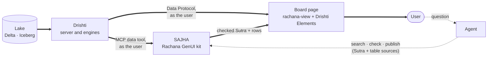
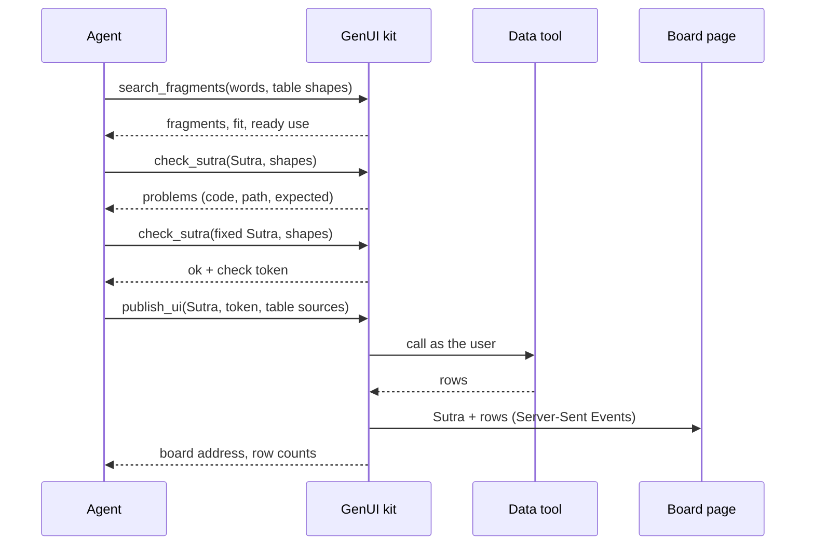

<!-- Copyright (c) 2026 Ashutosh Sinha. Proprietary. All rights reserved. -->
# GenUI on Rachana and Drishti: the architecture

For architects, senior technology managers and senior developers. Five chapters: why, the architecture, how an agent composes a
screen, one worked example, and where it applies. The detail lives elsewhere and is linked, not repeated: the kit's design
([GENUI_KIT](GENUI_KIT.md)), the guide for agent builders ([GENUI_GUIDE](../tools/sajha/docs/GENUI_GUIDE.md)), the tools'
contracts ([TOOLS](../tools/sajha/docs/TOOLS.md)), the libraries ([LIBRARIES](DESIGN.md#sutra-libraries-the-fragment-library-framework)) and the longer plan
([AI_GENUI](AI_GENUI.md)).

| Chapter | The one thing to take away |
|---|---|
| [1. Why: a market of one](#1-why-a-market-of-one) | every user gets a screen composed for their question, from governed parts |
| [2. Architecture](#2-architecture) | two paths kept apart: the agent handles names, the rows travel as the user and never through the model |
| [3. How the agent composes](#3-how-the-agent-composes) | search by words and data shape, compose, check, fix, publish; the grammar keeps infinitely many screens safe |
| [4. A worked risk mash-up](#4-a-worked-risk-mash-up) | VaR by desk, limits, exposure and news on one page, in 30 lines of YAML |
| [5. Applications and potential](#5-applications-and-potential) | risk, operations, the public sector, intranet applications; what is built and what is next |

Words used throughout: a **Sutra** is the YAML document that describes a screen; a **fragment** is a reviewed, parametrised
piece of screen published in a **library** (`core`, `finance`); a **board** is a published Sutra with its tables, open in a
browser; **SAJHA** is the MCP server the tools run in; **Drishti** is the risk and analytics platform that owns the lake, the
engines and the access rules.

---

## 1. Why: a market of one

**The gap.** An agent answers in text. A person who asks "how is risk today, and what changed?" wants a screen: their desks,
the breaches first, the drill they always do, the numbers moving while they look. Today that screen is either one of the fixed
dashboards somebody built last year for an average user, or a request in a backlog.

**The usual answers and why they fail in a regulated firm.**

| Approach | What goes wrong |
|---|---|
| A fixed dashboard per role | built for the average user; every new question is a change request |
| The model writes HTML or JavaScript | code from a model runs in the user's browser, with the user's session; nobody can review it before it runs |
| The model reads the data and draws a chart | the rows pass through the model: cost, leakage, prompt injection from a cell, and a number the model may have changed |

**The position taken here.** The agent composes a screen **at run time, for one user and one question**, out of parts that
were written, reviewed, tested and documented beforehand. It writes a description (a Sutra), never code. A compiler checks the
description completely before anyone sees it. The data arrives on a separate path, with the user's own rights. Every user can
have a UI made for them: a market of one.

What makes that acceptable to a risk or security function is that the freedom and the control sit in different places:

| Free (the agent decides) | Governed (the firm decides) |
|---|---|
| which fragments, in what order and layout | which fragments exist: the libraries, versioned, hashed and signed |
| titles, labels, formats, parameters | what a fragment can do: its declared parameters, columns and events |
| which of the offered tables fill which fragment | which data tools and hosts may supply rows; the user's rights on every row |
| derived fields written in the expression language | the grammar: no script, no markup, no addresses |
| when to update the open page | sizes, attempts, expiry; the audit record of every step |

Composition is unbounded on purpose. Consistency (one design system, accessibility, the same number formatted the same way)
and safety come from the grammar, not from limiting the choices.

---

## 2. Architecture

### 2.1 End to end



Thick arrows are the **data path** (rows). Dotted arrows are the **control path** (names, shapes and the Sutra). There is no
arrow from the lake, Drishti or a data tool's rows to the agent: that absence is the design.

### 2.2 Two paths

| | Control path | Data path |
|---|---|---|
| Carries | fragment documentation, table **shapes** (column names and types), the Sutra's text, problems, board ids | rows |
| Route | user → agent ⇄ the kit's four tools | lake → Drishti → the page, by one of two doors (below) |
| Passes through the model | yes | **never** |
| Checked by | the kit's rules and the Rachana compiler | Drishti's and the data tool's own rights, applied to the user |
| Size | kilobytes | up to tens of thousands of rows pushed; any size when the page reads the host |

The two doors of the data path, chosen per board when it is published:

| | Pushed by the kit | Read by the page |
|---|---|---|
| The agent names | a SAJHA data tool and its arguments | a Data Protocol host and a table |
| Rows travel | data tool → kit (inside SAJHA, as the user) → board server → page | Drishti → page, directly |
| Rights applied | the tool's, through SAJHA's inner-call path: the caller's grants, policy and audit | the host's, for whoever opens the page: row rules and masks |
| Fits | results of any MCP data tool, to a configured row limit | large or live tables; data that must not leave its host |

In both, the agent supplies a **source**, not the data. A user can never publish rows they could not read themselves.

### 2.3 Components

| Component | Where it lives | Role |
|---|---|---|
| Lake | Drishti (Delta or Iceberg tables) | the system of record for the rows |
| Drishti server and engines | Drishti | computes every risk number; applies entitlements, row rules and masks per caller; serves tables on the Data Protocol |
| SAJHA | the MCP server | signs users in, grants tools by role, audits every tool call, runs inner calls as the caller |
| Data tools | SAJHA (the deployment's own) | return rows for a query; publish their output schema, which is all the agent reads of them |
| Rachana GenUI kit | SAJHA plugin, [`tools/sajha/`](../tools/sajha/README.md) | four tools: `search_fragments`, `get_fragment`, `check_sutra`, `publish_ui`; the catalogue, the check, the row sources, the boards, the audit events |
| Libraries | [`libraries/core`, `libraries/finance`](../libraries/core/README.md) | 33 and 57 typed fragments; each carries a `doc` block and a manifest of file hashes |
| Rachana compiler | the drishti-rachana package (on V8 inside the kit; the same bundle in the page) | turns a Sutra and its libraries into a ViewModel or a list of problems |
| Agent | the firm's GenAI application, any model | turns the question into a Sutra using the four tools |
| Board server | inside the kit's process | holds boards (owner, version, expiry); serves the page, its assets and a Server-Sent Events stream |
| Board page | [`tools/sajha/spa/`](../tools/sajha/spa/app.js) | one `<rachana-view>`: compiles the Sutra again, answers its queries from the pushed rows or the Data Protocol host, paints with Drishti Elements |

Three contracts hold the parts together, each with a schema and conformance cases:

* **The Sutra grammar** ([spec/1/sutra.schema.json](../spec/1/sutra.schema.json)): what an agent may write.
* **The ViewModel** (Drishti's `docs/architecture/VIEWMODEL.md`): the compiled screen as data, with every value already
  formatted and every mask already applied; the painter walks it and evaluates nothing. The same contract feeds Drishti's own
  console and its embedding elements, so a generated board and a product screen look and behave alike.
* **The Data Protocol** ([spec/1/data-protocol](../spec/1/PROTOCOL.md)): tables, schema, query with a filter
  that travels as a syntax tree (never text), live changes. Authentication and authorisation stay the host's.

Arrow Flight, Drishti's door for notebooks, services and BI tools, is a third way out of the same lake with the same
entitlements. It is not on a board's path; it matters here because a firm that adopts GenUI does not get a second set of
access rules.

### 2.4 Trust boundaries

| Boundary | What crosses it | What cannot |
|---|---|---|
| Model ⇄ kit | text queries, table shapes, Sutra text, problems, a check token, a board address | rows (tools take shapes; publish takes sources); at most 200 constant rows the agent wrote itself |
| Kit → data tools | a tool name on the allow-list and arguments, called as the user | a tool not on the list; a call above the user's grants |
| Kit → page | a Sutra that passed the check for that exact text; rows; library files | an unchecked or altered Sutra (the token is an HMAC of the text's hash; publish checks again against the columns really fetched) |
| Page → network | itself, and Data Protocol origins on the allow-list (the page's Content-Security-Policy) | any address a Sutra names (`url:` sources are refused); any script not served by the board server |
| Page ← Sutra | data: compiled and checked again in the browser before painting | code: the grammar has no script, HTML, CSS or handlers; cell text is painted as text |

The model is treated as an untrusted author on every boundary: what it writes is checked by the kit, then again by the page.
The page does not trust the kit either.

A board's address is an unguessable capability link owned by its publisher. With pushed rows the board holds what the publisher
was allowed to read, so it is shared as a document would be; with the Data Protocol door the host decides again for each viewer.

---

## 3. How the agent composes

### 3.1 The `doc` block: documentation as data

Every fragment, and every Sutra, carries a `doc` block defined once in the schema (`$defs/doc`):

| Field | What the agent does with it |
|---|---|
| `summary`, `description` | decides whether the fragment answers the need |
| `use-when`, `avoid-when` | chooses between similar fragments; `avoid-when` names the better one |
| `data` (`in-words`, `sample-row`) | learns the rows it needs, in the fragment's own column names |
| `example` | starts from a minimal, valid use |
| `see-also`, `keywords`, `tags`, `category` | navigates and searches |

It is data with a schema, not a comment: the compiler lints it (problem `RCH-2093`, placed per field), a library fails its gate
without it, and the tools' output schemas refer to the same definition, so the agent receives typed fields rather than prose to
interpret. The catalogue is built from these blocks and the fragments' declared interfaces **only**; there is no second
description to drift.

### 3.2 Search: words and data shape

An agent knows two things: what the user asked, and what tables it can get. `search_fragments` takes both.

* **Text**: the request's words against name, keywords, summary, use-when, tags, category and description; rarer words weigh more.
* **Shape**: each table parameter of each fragment against the offered tables' columns (types first, then names: equal,
  synonyms, contained, shared words), scored as coverage of the required columns. A one-row table fills value parameters.

Each result carries the `doc`, the `fit` (coverage, the column mapping, what is missing) and a ready `use:` stanza already
mapped to the caller's columns. The search is deterministic: no embeddings and no model, so it can be tested and its answers
explained.

### 3.3 Check, fix, publish



* **Two layers of check.** The kit's rules first (about the deployment: sizes, offered tables and their columns, allowed
  libraries, known fragments, no addresses, no markup; codes `RGK-…`), then the compiler (about the language: parameters, types,
  expressions, layout; codes `RCH-…`).
* **Problems a model can act on.** Each has a code, a position, a JSON Pointer and the `expected` names, nearest first. The
  agent changes only the lines named.
* **Bounded.** Three attempts per user and Sutra, then `stop`: simplify or ask the user. The agent never loops.
* **The token.** A clean check returns a token bound to that exact text. `publish_ui` refuses any other text, fetches the rows
  itself, and checks once more against the columns the tables really have.

The codes the loop meets most:

| Code | Meaning | Fix |
|---|---|---|
| `RGK-112` / `RGK-111` | a column the table does not have / a table that was not offered | use one of `expected` |
| `RGK-121` / `RGK-120` | a fragment not in the catalogue / a library not listed or not allowed | search again / add the library |
| `RGK-110` | an address, or data rows written into the Sutra | publish the data as a table source |
| `RGK-130` | text that looks like markup or script | remove it; a Sutra holds words and expressions |
| `RGK-140` | too many attempts | simplify or ask |
| `RCH-2114` to `RCH-2116` | unknown, missing or wrongly typed parameter | read `get_fragment` |
| `RGK-170` / `RGK-171` / `RGK-172` | publish without a passing check / the Sutra does not fit the fetched tables / not the board's owner | check again / fix / publish a new board |

### 3.4 Libraries pinned

A Sutra names a library by major (`libraries: [core@1, finance@1]`) and a fragment by major (`finance/var-tiles@1`). Within a
major a fragment is frozen: the same parameters and data give the same ViewModel, checked mechanically against stored goldens.
Each library carries a SHA-384 per file; a deployment chooses which libraries an agent may use. So a board composed today
paints the same tomorrow, and a firm reviews a library once, not every screen made from it. Exact-version lock files and
publisher signatures are part of the library framework ([LIBRARIES](DESIGN.md#sutra-libraries-the-fragment-library-framework) 9 and 12).

### 3.5 Why infinitely many UIs stay safe

The number of possible boards is unbounded; the number of things a board can **do** is small and fixed. Five layers, each
independent of the model's good behaviour:

| Layer | What it guarantees | Where |
|---|---|---|
| Grammar | no place for script, HTML, CSS, handlers or an address; only named fragments, expressions and layout | the language |
| Schema | the Sutra, the `doc` block and every tool's input and output have one machine-checked shape | `spec/1/sutra.schema.json`, `tools/sajha/schemas/` |
| Lint and compile | every name, type, column and expression resolves, or the Sutra is not shown; the page compiles again | the kit's rules, the compiler, the runtime |
| RBAC | rows are fetched as the user, by tools and hosts on an allow-list; a board is updated only by its owner | SAJHA, Drishti, the kit |
| Audit | every search, get, check (hash, verdict, codes, attempt), publish (board, version, hash, each table's source and row count, never rows) and view is an event with the caller | the kit's audit hooks; SAJHA's tool-call audit |

Around them: limits (64 KB a Sutra, 60 panels, 12 tables, 50,000 rows a table, boards expiring after a day), a strict
Content-Security-Policy, and every asset served locally with no CDN. The threat-by-threat table is
[GENUI_KIT section 4](GENUI_KIT.md#4-safety).

---

## 4. A worked risk mash-up

**The question.** A head of market risk asks: "How is risk today, where are we against limits, where does exposure sit, and
is there news I should know?" No existing dashboard has exactly these four things.

**What the agent has.** One data tool on the allow-list, whose output schema describes five tables (names and types only):

| Table | Columns |
|---|---|
| `firm_risk` (one row) | `AS_OF`, `VAR_99`, `VAR_99_PREV`, `ES_975`, `VAR_LIMIT` |
| `var_by_desk` | `DESK`, `VAR_99`, `VAR_99_PREV`, `VAR_CHANGE` |
| `limit_use` | `LIMIT_NAME`, `LIMIT_USD`, `USED_USD`, `OWNER` |
| `exposure_by_cpty` | `COUNTERPARTY`, `SECTOR`, `EXPOSURE_USD`, `PNL_USD` |
| `news` | `PUBLISHED`, `HEADLINE`, `SOURCE`, `LINK` |

### 4.1 What the agent did, step by step

| Step | Call | Result |
|---|---|---|
| 1 | read the data tool's output schema | five shapes; no rows |
| 2 | `search_fragments("var es tiles at the head of a risk screen", firm_risk)` | `finance/var-tiles@1`, coverage 1.0 |
| 3 | `search_fragments("rank desks by value at risk", var_by_desk)` | `core/ranked-bars@1`, coverage 1.0 |
| 4 | `search_fragments("many limits utilisation breaches first", limit_use)` | `finance/limit-table@1`, coverage 1.0 |
| 5 | `search_fragments("where exposure concentrates by counterparty and sector", exposure_by_cpty)` | `finance/concentration-treemap@1`, coverage 1.0 |
| 6 | `search_fragments("measure with signed change by name", var_by_desk)` | `core/measure-table@1`, coverage 1.0 |
| 7 | `search_fragments("news headlines newest first", news)` | `core/headline-list@1`, coverage 1.0 |
| 8 | `get_fragment("core/measure-table@1")` | its optional column `second`; the agent maps it to `VAR_CHANGE` |
| 9 | compose: the six ready `use:` stanzas, a `data:` entry per table, a `doc:`, titles and formats | a first draft, with one slip: `ES_99` written from memory |
| 10 | `check_sutra` (attempt 1) | `RGK-112` at `/panels/0/with/es`: table `firm_risk` has no column `ES_99`; expected `ES_975`, … |
| 11 | fix that one line; `check_sutra` (attempt 2) | ok, a check token |
| 12 | `publish_ui(Sutra, token, sources)`: each table as `{tool, arguments, path}` | the kit calls the data tool as the user; the board's address and each table's row count come back |
| 13 | the next intraday run: `publish_ui` again with `board: <id>` | the open page repaints in place |

At no step did a row reach the model. The agent handled twenty-one column names and one 30-line document.

### 4.2 The Sutra in full

```yaml
rachana: 1.2
sutra: risk-mashup
version: 1
doc:
  summary: Firm VaR and ES, VaR by desk, limit use, exposure by counterparty, what changed and the day's news.
  description: >-
    A risk mash-up composed by an agent from the core and finance libraries over five tables of the day. Figures are
    supplied by the risk systems; nothing is computed on the board but changes and shares.
  category: market-risk
libraries: [core@1, finance@1]
title: { id: "'Risk mash-up'" }
data:
  firm_risk: { table: firm_risk, as: record }
  var_by_desk: { table: var_by_desk }
  exposure_by_cpty: { table: exposure_by_cpty }
  limit_use: { table: limit_use }
  news: { table: news }
panels:
  - use: finance/var-tiles@1
    with: {"es": "$.firm_risk.ES_975", "var": "$.firm_risk.VAR_99", "limit": "$.firm_risk.VAR_LIMIT", "previous-var": "$.firm_risk.VAR_99_PREV", "var-label": "VaR 99% 1d", "es-label": "ES 97.5% 1d"}
  - use: core/ranked-bars@1
    with: {"rows": {"from": "$.var_by_desk", "columns": {"label": "DESK", "value": "VAR_99"}}, "title": "VaR by desk", "fmt": "amount0"}
  - use: finance/limit-table@1
    with: {"rows": {"from": "$.limit_use", "columns": {"name": "LIMIT_NAME", "limit": "LIMIT_USD", "used": "USED_USD", "owner": "OWNER"}}, "title": "Limit use"}
  - use: finance/concentration-treemap@1
    with: {"rows": {"from": "$.exposure_by_cpty", "columns": {"group": "SECTOR", "name": "COUNTERPARTY", "exposure": "EXPOSURE_USD", "pnl": "PNL_USD"}}, "title": "Exposure by counterparty"}
  - use: core/measure-table@1
    with: {"rows": {"from": "$.var_by_desk", "columns": {"name": "DESK", "first": "VAR_99", "second": "VAR_CHANGE"}}, "title": "What changed since yesterday", "name-label": "Desk", "first-label": "VaR", "second-label": "Change", "first-fmt": "amount0", "second-fmt": "signed0"}
  - use: core/headline-list@1
    with: {"rows": {"from": "$.news", "columns": {"date": "PUBLISHED", "headline": "HEADLINE", "source": "SOURCE", "link": "LINK"}}, "title": "Market news", "limit": 10}
```

Reading it as a reviewer would:

* **Six panels, six fragments, two libraries.** Nothing on the page was drawn by the model; each panel is a reviewed fragment
  with its own tests and goldens.
* **`data:` names tables; it holds none.** The rows are bound at publish time from the sources.
* **`columns:` maps the firm's names onto the fragment's.** The compiler renames at compile time; nothing is copied.
* **No number is computed by the model or the board** beyond what a fragment declares (a change, a share). VaR, ES and exposure
  are Drishti's figures, as supplied.
* **The news panel raises an event with the item's link when clicked;** it does not open addresses by itself. What happens next
  is the host page's decision.

### 4.3 What exists of this example

The first five panels over the first four tables are the checked-in example: the Sutra
[`risk-mashup.sutra.yaml`](../tools/sajha/example/risk-mashup.sutra.yaml) and the script
[`risk_mashup.py`](../tools/sajha/example/risk_mashup.py), which plays the agent's part deterministically (no model) on
synthetic data, including the wrong column, the fix and the live update. The news panel and its table are added in this
chapter: `core/headline-list@1` is in the `core` library, and the search and the kit's rules were run on the six-panel text
above with the results shown in steps 7, 10 and 11; the compiler's pass on it, and a `news` view in the example's synthetic data
tool, are not on the branch.

---

## 5. Applications and potential

### 5.1 Where it applies

| Domain | A question that becomes a board | What it needs beyond today's parts |
|---|---|---|
| Risk | "VaR against limits by desk, the three largest moves, and exposure to the names in today's news" | nothing: `core` and `finance` cover it (chapter 4) |
| Operations | "Today's breaks by system and age, the feeds that are late, who holds each exception" | `core` covers tables, timelines, freshness and audit trails; an operations library would add domain fragments |
| Public sector | "Unemployment, inflation and the policy rate for these five economies, with the latest official releases" | `core` covers figures, charts and headlines; a public-sector library and data tools over the published statistics |
| Embedded in intranet applications | a client page in a CRM that asks for "this client's exposure and limits" and shows the answer in place | the host page loads `<rachana-view>` and follows a board ([GENUI_GUIDE](../tools/sajha/docs/GENUI_GUIDE.md) 5); no iframe required by the element |

The common property: many users, each with a slightly different question, over data that is already governed. The cost of one
more screen falls from a development task to one conversation, and the firm's review effort moves from screens to libraries.

A firm extends the system by writing fragments, not prompts: a private library with complete `doc` blocks joins the catalogue,
and every agent can use it the same day.

### 5.2 Adoption path

| Stage | What the firm does | What it proves |
|---|---|---|
| 1. Try | run the example on its own, on synthetic data | the loop, the check and the live page, with no model and no server |
| 2. Pilot | deploy the plugin into SAJHA; allow one data tool and the `core` and `finance` libraries; one agent, one team | rows as the user; the audit trail; how often the first check passes |
| 3. Own data at scale | allow a Drishti origin so boards read tables on the Data Protocol | row rules and masks per viewer; large and live tables |
| 4. Own fragments | a private library for the firm's own measures and wording | governance by library review |
| 5. Embed | `<rachana-view>` in intranet applications, following boards | GenUI inside existing applications rather than beside them |

Each stage is useful by itself and none requires changing Drishti or SAJHA.

### 5.3 Built today, and next

"Built" means present on the branch `genui/kit-lite`. Nothing else is claimed.

| Part | State on the branch |
|---|---|
| The `doc` block in the schema (`$defs/doc`) | built |
| `doc` blocks on every fragment of `core` (34) and `finance` (57) | built |
| The compiler's doc lint (`RCH-2093`, Java) | built; Maven build and suites green |
| The four tools, their schemas, the catalogue (text and shape search), the check with tokens and bounded attempts, the three row sources, boards and the board server, audit events and hooks | built, with a light test suite (17 tests) |
| The doc lint inside the kit | built as a Python mirror; asking the compiler's own lint on V8 is next |
| The compiler's pass inside `check_sutra` | built; needs the package's V8 extra and bundle installed, and says so (`RGK-150`) when they are not |
| The board page (`spa/`) | built; checked in Chromium (paint, live update over SSE, strict Content-Security-Policy) |
| The Data Protocol door (allow-listed origin, the page reading the host) | built in the kit and the page; not yet exercised against a Drishti server |
| Fetching rows as the user through SAJHA's inner calls | built against SAJHA's interfaces; outside SAJHA a registered Python function stands in, which is what the tests and the example use |
| The risk mash-up example (five panels, four tables, synthetic data) | built |

Next, in the order the design gives them ([GENUI_KIT](GENUI_KIT.md) 7, [AI_GENUI](AI_GENUI.md) 8):

1. The Maven build and suites for the doc lint; the kit asking the compiler for the lint.
2. The browser check of the board page.
3. A run against a live SAJHA and a Drishti Data Protocol host; the news view in the example.
4. The same catalogue and check inside Drishti, with boards as short-lived Sutras reading Drishti's tables as the viewer.
5. `doc` blocks on Drishti's own Sutras, so the product's screens become parts an agent can find.
6. An evaluation set (how often a first draft passes, how many fixes, whether the board answers the question), the prompt
   kit, and per-user preference memory.
7. Domain libraries beyond `core` and `finance`.

**Known limit worth stating.** Shape search maps columns by name semantics first (exact, synonym, shared words: a headline column
called `TITLE` beside a text column `PUBLISHER` maps `headline` to `TITLE`, `source` to `PUBLISHER`), and by type only for a required
column no name fits. A column whose name shares nothing with the fragment's can still be mapped wrongly while coverage reads 1.0;
the agent corrects it from the fragment's `doc` (`data.sample-row`, `example`), and the check cannot catch a mapping that is
type-correct. The evaluation set is where this is measured.
