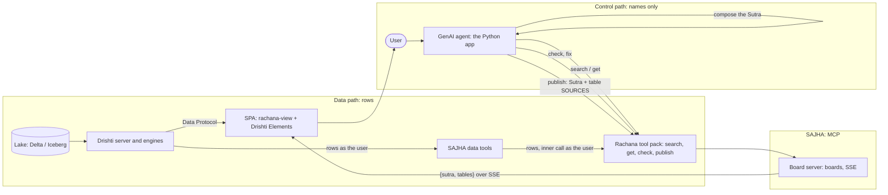

<!-- Copyright (c) 2026 Ashutosh Sinha. Proprietary. All rights reserved. -->
# The GenUI kit: design

Status: **kit lite written** (`tools/sajha/`, tested on its own); the compiler's doc lint and schema written, to be built. This
document is the architecture; [AI_GENUI](AI_GENUI.md) remains the longer plan (prompt kit, evaluation harness) and this kit is its first host. How to use it: [tools/sajha/docs/GENUI_GUIDE.md](../tools/sajha/docs/GENUI_GUIDE.md).

## 1. The idea: a market of one

Agents answer in text and JSON. A user who asks "how is risk today, and what changed?" wants a **screen**: the figures that matter
to them, the breaches first, the drill they always do, live. The kit lets an agent compose that screen **at runtime, for that one
user**, from reviewed parts, and hand it over as a page that works like any product screen. Every user can get a UI made for
them: a market of one.

Composition is unbounded on purpose: any fragment, any parameter, slots filled with the user's own panels, nesting, layouts, plain
panels of any kind, Rachana-EL derived fields, any data shape. Consistency and safety come from the **grammar** (one design system,
accessibility, no code, checked names), not from limiting the choices.

## 2. End to end

Two paths, kept apart:

| | Control path | Data path |
|---|---|---|
| Carries | fragment docs, table **shapes** (column names and types), the Sutra text, problems, board ids | rows |
| Between | the agent and the kit's tools | lake → Drishti → (a SAJHA data tool → the kit → the board server) or (Data Protocol) → the page |
| Through the model | yes | **never** (GD4): the agent names a table's source, the kit fetches it as the user |
| Checked by | the compiler and the kit's rules | the data tool's and Drishti's own rights (row rules, masks), applied to the user |

The page never trusts the agent either: it compiles the Sutra again with the runtime bundle before painting.

## 3. Parts

| Part | Where | Does |
|---|---|---|
| The doc block | SPEC 2.9; `$defs/doc` of `spec/1/sutra.schema.json`; lint `RCH-2093` (`DocBlockLint`) | the contract a fragment publishes: summary, description, category, tags, use-when, avoid-when, data (in words, a synthetic sample row), example, see-also, keywords |
| The catalogue | `rachana_genui/catalogue.py`, `catalogue/generate.py` | built from the libraries' doc blocks and declared interfaces only; text search and shape search (coverage, mapping, ready `use:`) |
| The check | `rachana_genui/checker.py` | the kit's safety rules, then the compiler on V8 with the libraries used; problems placed, with `expected`; bounded attempts; a check token |
| Row sources | `rachana_genui/rows.py` | a SAJHA data tool called as the user (allow-listed), a Data Protocol host (allow-listed), or a few constant rows the agent wrote |
| Boards | `rachana_genui/boards.py` | versions, owner, expiry; the server: page, SSE, board JSON, library files, the wheel's assets |
| The page | `spa/` | one `<rachana-view>`; pushed rows answered in the page by the runtime's own query (`StaticHost`), or the Data Protocol host read directly |
| The tools | `tools/*.py`, `schemas/*.json` | SAJHA's plugin format; output schemas embed `$defs/doc` by `$ref` |

### 3.1 Why the doc block is in the schema

The catalogue, the component browser, the generated library pages and the agent read the same fields, so they are data with a
schema, not comments: the compiler lints them (`RCH-2093`, placed per field), the library gate fails a library on them, and the
tool output schemas carry the same definition, so the agent receives typed fields (`use-when`, `data.sample-row`, `example`)
instead of prose to interpret. One definition (`DocSchema` in Java, copied to the kit's `doc.schema.json`, kept equal by a test).

### 3.2 Search by data shape

An agent usually knows two things: what the user asked, and what tables it can get. Shape search matches each fragment's table
parameters against the tables' columns (types first: a number column fills a number column; then names: equal, synonyms such as
label/desk/counterparty, contained, shared words such as `VAR_99_PREV` for `previous-var`), scores the coverage of required
columns, and answers the mapping as a ready `rows: { from: $.t, columns: {...} }`. A one-row table (`as: record`) fills value
parameters (`var: $.firm_risk.VAR_99`). Deterministic and testable; no embeddings.

### 3.3 The check-fix loop

Kit rules first (cheap, about the deployment: sizes, offered tables and their columns, allowed libraries, known fragments, no
addresses, no markup), then the compiler (the language: parameters, types, expressions, layout). Problems carry the JSON Pointer
and the expected names; the agent changes only the lines named. Three attempts, then `stop`. A clean check returns a token bound to
the exact text (HMAC of its hash); `publish_ui` refuses any other text and checks again against the columns the tables really have.

## 4. Safety

| Threat | Why it fails | Enforced by |
|---|---|---|
| The model writes code | nowhere to put it: the grammar has no script, HTML, CSS or handlers; markup-like text refused (`RGK-130`); the page paints strings as text | grammar; kit; painter |
| An unchecked or altered Sutra is shown | publish needs a check token for the exact text; the page compiles it again | `checker.token_ok`; runtime |
| Rows flow through the model (cost, leakage, injection) | tools take shapes; publish takes sources; inline rows only for at most 200 constants the agent wrote | `rows.py`, schemas |
| Data the user may not see | data tools run as the user through SAJHA's inner calls (rights, policy, audit); Data Protocol hosts apply their own row rules | SAJHA; Drishti |
| Exfiltration by address | `url:` sources refused; Data Protocol origins allow-listed and the only `connect-src` of the page's CSP besides itself | kit; CSP |
| Prompt injection in cells | cells reach the page only, as text; the model never sees them | the data path |
| Resource exhaustion | 64 KB Sutra, 60 panels, 12 tables, 50,000 rows a table, 3 attempts, 500 boards, 24 h expiry, V8 memory and time limits | settings; engine |
| A board updated by someone else | a board belongs to its publisher; updates by others refused (`RGK-172`) | boards |
| Who may open a board | a board's address is the access: the board server has no sign-in of its own, so whoever holds `/b/<id>` (128 random bits) or `/b/<id>/board.json` reads the rows fetched with the publisher's rights; keep `RACHANA_GENUI_HOST` on a loopback or private interface, or put the port behind a proxy that signs readers in; the `view` audit event has no reader identity; tokens and boards live in one process (several SAJHA workers need the same `RACHANA_GENUI_SECRET` and still do not share boards) | boards; deployment |
| Supply chain in the page | every asset from the wheel (vendored Elements, runtime bundle with its recorded SHA-256); no CDN; `script-src 'self'` | board server; CSP |

The page's policy: `default-src 'none'; script-src 'self'; style-src 'self' 'unsafe-inline'; img-src 'self' data: blob:; font-src
'self' data:; connect-src 'self' <allowed origins>; worker-src 'self' blob:; base-uri 'none'; form-action 'none'; frame-ancestors
'self'; object-src 'none'`. Inline styles are allowed for the painter's chart markup (style attributes, never script); the page is checked in Chromium
with the built bundle (paint, live update, CSP).

## 5. Audit

Every search, get, check (hash, verdict, codes, attempt), publish (board, version, hash, each table's row count and **source**, not
its rows) and board view is an event `rachana.genui.<kind>` with the caller, to the log, an optional JSON-lines file, and any hooks
(`audit.add_hook`: a SIEM, SAJHA's audit store). SAJHA audits the tool calls themselves as for any tool.

## 6. Deployment

| Topology | How |
|---|---|
| SAJHA plugin (first) | the folder under `config/plugins/`; the board server inside SAJHA's process; the board server has no sign-in of its own: behind SAJHA's proxy and sign-in, or on a loopback or private interface (section 4) |
| Plain Python app | the tool classes called directly, data functions registered (`rows.register_tool`) |
| Drishti (later, i9) | the same check and catalogue in process (Java: `DocBlockLint`, the library reader); boards as ephemeral Sutras reading Drishti's tables as the viewer |
| Air-gapped | nothing fetched at run time: libraries, assets and bundle are local files |

## 7. What is open

Built and checked: the Java changes (`DocBlockLint`, `DocSchema`, the panel `doc` key, the parts' doc as a block, LG3) with their suites, and the board page `spa/` in Chromium.

1. The bundle exports `DocBlockLint` so the kit asks V8 instead of its Python mirror (`rachana_genui/doclint.py`).
2. Drishti's ~548 Sutras get their doc blocks (a lane), and its guard test.
3. Preference memory per user and an evaluation set (AI_GENUI 6) with Drishti i9.
